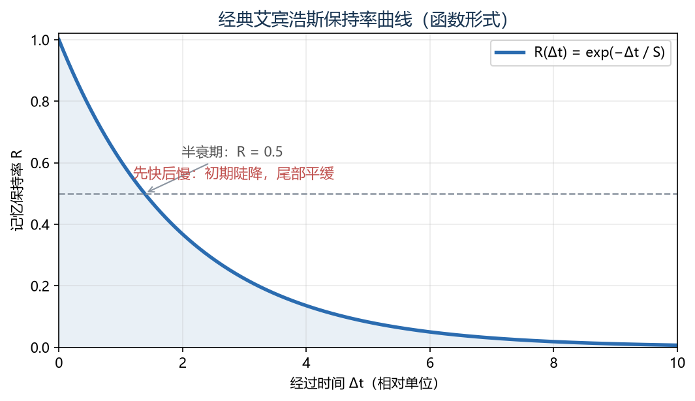
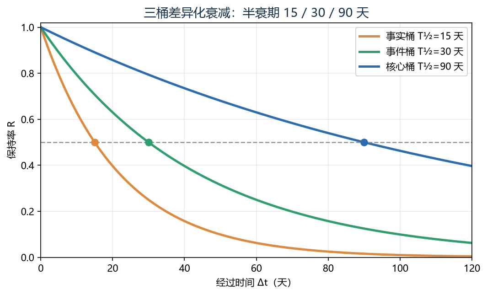
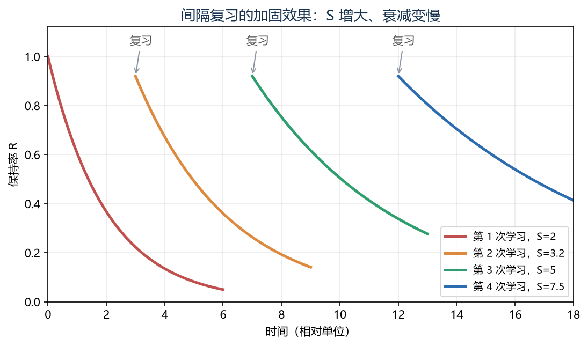
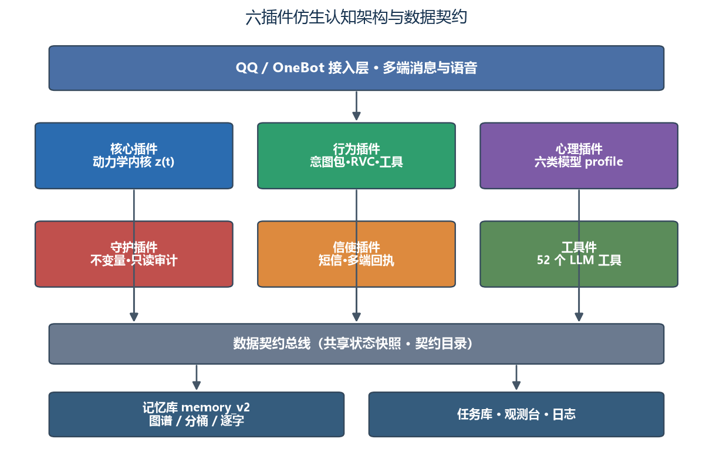
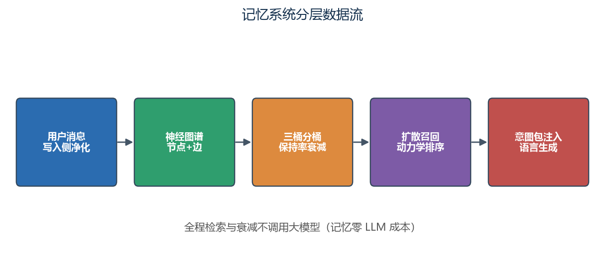

# 识海：融合人格心理学的 QQ 数字生命耦合动力系统

### —— 基于 AstrBot 的多插件仿生认知架构

第二十届全国大学生软件创新大赛 · 面向移动终端的系统级智能体验

识海项目组 · 大连理工大学软件学院

2026 年 11 月

---

## 摘要

本文提出"识海"架构，把一个长期陪伴的 QQ 数字生命建模为耦合动力系统

z(t) = [ e(t), a(v,t), θ(t), ψ, u(t), g(t) ]，

其中 e 为六维情绪场、a(v,t) 为神经图谱节点激活、θ 为可在线学习的慢参数、ψ 为大五人格特质、u 为主动开口的念头强度、g 为顶层内生目标向量。架构以"**动机动力学与语言生成解耦**"为第一原则：独立的确定性状态系统负责"何时说、为何说"，大模型仅负责"怎么说"。

系统在工程上已重构为**六个职责单一的识海插件**（核心、行为与适配、心理、守护、信使、工具件），通过数据契约协作。核心机制包括：神经图谱扩散激活替代扁平向量检索；事实/事件/核心三桶按艾宾浩斯保持率分桶衰减（半衰期 15/30/90 天）；Hebbian 边权自学习实现零 LLM 记忆管线；六类心理学模型在状态空间中找到可观测落点；念头累积叠加由头锚点与"自我许可"门控，驱动可解释的主动开口；用户反馈驱动 θ 在线自适应；目标向量 g 驱动内生行为倾向；探索—利用平衡与有界三层慢演化使行为先验可自我调整。

在表达侧，本文给出性格层/心情层正交的双层表达模型与提示词瘦身路线；在一致性侧，把记忆错乱、上下文割裂、人格分裂、行动割裂四类故障形式化为可计数判据，对应四条运行期不变量（时序单调、通道隔离、表达归界、解释权唯一），融合"写入侧净化—检索侧拦截—生成侧归界—行动侧在场—生成后校验"五道防线。离线仿真 **11 组数值检查全部通过**，综合故障率由 1.540 降至 0.065（降幅 95.8%）。生活任务层把短信快递做成可闭环的确定性状态机，与动力学共用同一份状态快照。文末如实标注未实现项与外部效度边界。

**关键词**：数字生命；耦合动力学；人格心理学；主动行为；一致性守护；生活任务

---

## 目录

1. 引言
2. 问题定义、研究边界与理论依据
3. 符号说明
4. 系统总览与多插件架构
5. 耦合动力学：情绪场、念头与自我调节
6. 记忆系统：神经图谱、分层融合与数据净化
7. 人格心理学建模
8. 行为空间、策略选择与自演化
9. 表达层：意图包与双层模型
10. 一致性守护
11. 生活任务层：从短信到闭环
12. 上下文闭合
13. 数值自洽性验证
14. 观测台与工程部署
15. 限制、伦理与外部效度
16. 结论

---

# 第 1 章 引言

## 1.1 从单点问答到持续陪伴

主流陪伴 AI 把情绪、动机、人格全部交给大模型隐状态：同一句话换一个会话就可能换一种心情；主动行为由提示词或定时器触发，既不可控，也无法解释"为什么此刻主动"。其根本原因是**把两件不同的事压在了同一个模型里**——"何时说、为何说"的动机决策，与"怎么说"的语言生成。

识海把前者从语言生成中拆出来，交给一个独立的、可观测的时序状态系统；大模型退到表达层，只负责把已经决定的意图组织成自然语言。这条分界线带来三个直接后果：

1. **情绪可以跨会话残留**：情绪是带弛豫时间的连续变量，不被单轮对话重置；
2. **记忆可以差异化衰减**：不同类型、不同重要度、不同情绪色彩的记忆以不同速率消退；
3. **每个自发动作都可回溯**：能指回具体的情绪、记忆、念头或任务来源，而不是黑箱输出。

## 1.2 本文的组织方式

第 2—3 章定义问题、理论边界与符号；第 4 章给出多插件系统总览；第 5—8 章给出情绪、记忆、人格、行为与演化的机制；第 9—12 章给出表达层、守护层、生活任务层与上下文闭合；第 13—14 章给出数值验证与工程部署；第 15—16 章讨论边界并收束结论。

## 1.3 主要贡献

1. 提出六分量耦合状态 z(t)=[e,a,θ,ψ,u,g]，把情绪场、图谱激活、慢参数、人格、念头与目标写进同一组方程；
2. 把"念头越阈即发送"改为"**越阈且自我许可**"，用门控调节器解释"为什么现在说、为什么不是下一次"；
3. 把 **13 条注册行为与 52 个 LLM 工具**收进统一动作空间，并保留 24 类设计空间的可扩展口径；
4. 给出**多插件架构与数据契约**：六个职责单一的插件通过契约目录协作，动力学与平台解耦；
5. 新增生活任务层，把短信快递做成确定性状态机，与动力学共用一份状态快照；
6. 用 **11 组数值检查全部通过**与真实运行日志验证链路自洽，并把四类故障形式化为可计数、可回归的守护判据；
7. 给出会话隔离、记忆作用域与短上下文三处闭合机制，同时如实标注外部效度边界。

---

# 第 2 章 问题定义、研究边界与理论依据

## 2.1 形式化问题

给定用户消息流 X={x₁,…,xₙ}、历史交互记忆 M={(xᵢ,yᵢ,tᵢ)}、以及情境 C（时间、课表、地点、短信、设备状态），要求构建系统

f : (X, M, C) → (Y, e, a, T)，

其中 Y 为回复序列，e(t) 为连续情绪状态，a(v,t) 为记忆激活状态，T 为生活任务状态。系统需同时满足：

- **(a) 情绪连续性**：e(t) 不随单轮跳变，跨会话保留残留；
- **(b) 记忆可累积**：新交互写入图谱，旧记忆按情感强度差异化衰减；
- **(c) 行为可解释**：每个自发动作可回溯到情绪、记忆、念头或任务来源；
- **(d) 记忆零 LLM 成本**：检索与衰减不调用大模型；
- **(e) 任务可闭环**：发现、确认、排期、提醒、回执、归档六个环节不丢状态。

## 2.2 与现有方案的差异

"强 LLM + Prompt + 向量记忆"方案能生成像样的句子，却难以回答：为什么此刻主动？为什么是这件事？为什么不是下一次？向量检索还需为全量记忆支付嵌入成本，且召回是互不相干的 top-k 切片。识海把动机、情绪、记忆与任务做成可读的时序变量，以神经图谱扩散获得"相关的一串记忆"而非孤立切片，并把语言生成降为表达层。

## 2.3 研究边界

本文**不宣称系统具备意识或主观体验**。心理学概念只作设计动机与功能类比，不作为系统模块名；代码与接口不按"本我—自我—超我"命名（如出现该映射，仅用于解释功能分层）。当前版本为单用户设计：私聊一人一会话；群聊在唯一会话键下把短上下文按"发送者_群号"隔离，长期事实以发送者为键归并，而内核 z(t) 与图谱仍是单一自我。多用户各自独立心智、多平台实例与独立手机端仍未实现。仿真只证明数值自洽与边界行为，不证明线上因果。

## 2.4 理论依据及其形式化落点

建模不是从零构造，而是从六个已有理论中各截取一部分，改写为可计算的时序变量。取舍标准有二：能否落成**不调用大模型的确定性更新**（指数衰减、加权求和、阈值比较、计数）；被截取部分能否对应到一个**可观测的量**。以下逐条说明"借用什么、放弃什么"，把放弃的部分写清楚，以免把"借用了理论的名字"当成"实现了那个理论"。

**全篇总声明**：文中心理学术语（防御、压抑、置换、投射、记忆干扰等）均作功能类比，其工程定义以具体触发条件与输出行为为准，不构成心理模块划分，也不能反过来用于推断用户心理。

### 2.4.1 艾宾浩斯保持率曲线

本节把艾宾浩斯遗忘曲线从"借用一个公式"展开为完整建模：经典形式 → 分桶衰减率标定 → 强度三因子 → 复习加固 → 离散实现。需要强调，我们借用的是其**函数形式**而非无意义音节实验的数值结论。

**（1）经典形式。** 保持率随时间"先快后慢"地指数下降，经典形式写为

$$ R(\Delta t)=\exp\!\left(-\frac{\Delta t}{S}\right) \tag{2-1} $$

其中 $S$ 为记忆强度（时间尺度），$R\in(0,1]$，$\Delta t$ 为距上次巩固的经过时间。

**（2）分桶推广与衰减率标定。** 识海不使用单一 $S$，而是按事实 / 事件 / 核心三桶分别设定基础衰减率 $\lambda$，并引入强度倍数 $S$：

$$ R(\Delta t)=\exp\!\left(-\frac{\lambda\,\Delta t}{S}\right) \tag{2-2} $$

基础衰减率与半衰期 $T_{1/2}$ 的关系由 $R(T_{1/2})=0.5$ 反解：当 $S=1$ 时 $\lambda=\ln 2 / T_{1/2}$。三桶的工程标定半衰期与对应每小时衰减率如下（$\Delta t$ 以小时计）：

| 记忆桶 | 半衰期 $T_{1/2}$ | $\lambda$（每小时，$S=1$） |
|---|---|---|
| 事实桶 | 15 天 | $1.93\times10^{-3}$ |
| 事件桶 | 30 天 | $9.63\times10^{-4}$ |
| 核心桶 | 90 天 | $3.21\times10^{-4}$ |

**（3）强度三因子。** 记忆强度由重要度、情绪峰值、复习计数三个可观测因子相乘得到：

$$ S=(1+\beta\cdot imp)\,(1+\alpha_E E_v)\,(1+\beta_N N_{recall}) \tag{2-3} $$

其中 $imp$ 为重要度自评、$E_v$ 为事件情绪峰值、$N_{recall}$ 为跨天复习计数。$S$ 越大，等效衰减率 $\lambda/S$ 越小，等效半衰期被拉长。

**（4）复习加固。** 每发生一次跨天复习，$N_{recall}$ 增大、$S$ 抬升，曲线在复习点重新抬高且后续衰减变慢（图 2-3）。这正是间隔重复（spaced repetition）在状态空间中的计算表达，也与 2.4.2 的 Hebbian "用进废退"相互呼应。

**（5）离散实现。** 工程落盘按时间戳做精确指数计算，而不采用 $(1-\lambda\Delta t)$ 的线性近似：

$$ R_k=\exp\!\left(-\frac{\lambda\,\Delta t_k}{S}\right) \tag{2-4} $$

精确指数在长间隔下不会出现线性近似导致的负值或超调，且无需固定步长即可处理任意时间间隔。

**边界**：原曲线来自无意义音节实验，本文不主张其精确描述语义记忆；三桶半衰期（15/30/90 天）是工程标定而非人群测量值；$\lambda$ 与三因子系数会在后续实地验证中校准。

### 2.4.2 赫布学习与扩散激活

"同时被激活的连接增强"，激活沿已有连接扩散。边权增量与激活更新承担的是**召回的形状**——从种子沿边扩散得到一串相关记忆。**边界**：扩散只沿已有边、全程不调用大模型；边只表示共现或关联，代码中不存在可调用的因果判定器，不做因果承诺。

### 2.4.3 记忆干扰：前摄/倒摄抑制与来源混淆

新旧记忆可能相互压制或被错误拼接。后者对应来源混淆（source confusion），而非对记忆空缺的虚构填补。该机制没有被实现成"再加一个遗忘项"，而是变成**边的准入约束**：门一要求两端发送者相同（硬约束），门二对 24 小时内、尚未被反复共现确立的边只加 γ·0.2 的弱权重。作用是防错构，而非提升召回。

### 2.4.4 情绪连续动力学

情绪不是离散标签，每一维有自己的弛豫时间，维间存在互激励，写成六维一阶常微分方程。它保证情绪跨轮、跨会话残留。**边界**：互激励矩阵采用对称假设以保留梯度流解释，非对称情形未作稳定性证明。

### 2.4.5 自我调节与防御机制

冲动足够强不等于此刻该表达，中间存在一层调节，落成释放许可与阈值抬升：高位放行、低位拦截、抑制居中。它把"该不该说、以什么策略说"从语言模型手中拿走，交给确定性规则。**边界**：只借用"调节"的功能结构，不采用本我/自我/超我划分；相关机制是可观测的参数动作，不是心理诊断。

### 2.4.6 大五人格作为慢变量

ψ=(O,C,E,A,N) 归一到 [0,1]，是月级慢变量，只调制参数、不直接决定文本。单轮负反馈最多改变参数，不能推翻人格。**边界**：开放性、尽责性、宜人性在状态中保留但尚未全部进入更新方程，不宣称其有调制作 用；"高外向更主动、高神经质恢复更慢"是参数化设计选择，未经人群标定。

六个理论的共同落点：都能写成不含大模型的确定性更新。凡必须调用大模型才能判定的量——语义相似、重要度、因果——都显式标注为代理指标，而非理论结论。

---

# 第 3 章 符号说明

全文统一符号如下（时间单位除特别说明外均为小时 h）。

| 符号 | 含义 | 量纲/取值 |
|---|---|---|
| z(t) | 系统六分量状态 | — |
| e(t) | 六维情绪场（happy/sad/angry/fear/love/surprise） | ℝ⁶，[0,1] |
| a(v,t) | 节点 v 的激活值 | [0,1] |
| θ(t) | 慢演化参数（衰减率、阈值、边先验等） | ℝᵈ |
| ψ | 大五人格 (O,C,E,A,N) | ℝ⁵，[0,1] |
| u(t) | 主动开口念头强度 | ℝ，上界 3.0 |
| g(t) | 顶层目标（关系/记忆/自我/回避） | ℝ⁴ |
| s_ext | 外部情绪刺激（用户输入推断） | ℝ⁶ |
| s_int | 内部情绪刺激（记忆召回注入） | ℝ⁶ |
| τ | 情绪弛豫时间常数 | h |
| κ | 刺激增益 | 标量 |
| η | 情绪自相关系数 | 标量 |
| W | 情绪互激励矩阵（对称 W=Wᵀ） | 6×6 |
| γ | Hebbian 学习率 | 标量（0.06） |
| α | 情绪—衰减耦合强度 | 标量 |
| β | 目标—策略耦合系数 | 标量（0.8） |
| λ | 分桶基础衰减率 | h⁻¹ |
| imp | 重要度自评 | [0,1] |
| r_feedback | 社交反馈信号 | [0,1] |
| r_goal | 偏好满足度 | 4 维 |
| η_adapt / η_ψ | 自适应/人格学习率，η_ψ≈η_adapt/100 | 标量 |
| ε | 探索系数 | [0, ε_max]，ε_max=0.35 |
| n(b) | 行为 b 的新颖性权重 | [0,1] |

> 说明：早期文档曾出现"边权时间衰减常数 τ_M=36 h"的连续指数衰减表述。**当前代码并不存在该连续衰减项**：边权在 Hebbian 更新中只增不减，弱边在"做梦"阶段按阈值（edge_init×0.4）统一剪枝。本文据此不再使用 τ_M 符号。

---

# 第 4 章 系统总览与多插件架构

## 4.1 从单插件到六插件

系统早期以单个插件承载全部逻辑，随着能力增长，已重构为**六个职责单一、通过数据契约协作的识海插件**，均位于 `data/plugins/`。拆分的收益是：动力学内核保持精简稳定，重逻辑（工具箱、RVC、画图）隔离在行为插件，守护与心理等横切能力可独立演进，且任一插件故障不污染内核状态。

| 插件 | 版本 | 职责 | 关键结构 | LLM 工具 |
|---|---|---|---|---|
| `astrbot_plugin_shihai`（核心） | 1.1.0 | 动力学内核 z=[e,a,θ,ψ,u,g] | `mind/`：state、emotion、graph、urge、ego、engine、adapt、classify、goals | 5 |
| `astrbot_plugin_shihai_behavior`（行为与适配·总成） | 3.0.0 | 行为空间、策略、意图出口、工具箱、RVC、画图、短记忆 | `behavior/`、`modules/`、cover.py、draw.py、dafeiyu_core.py、behaviors.json | 约 37 |
| `astrbot_plugin_shihai_psyche`（心理） | 1.0.0 | 六类心理学模型 | `psyche/profile.py` | 3 |
| `astrbot_plugin_shihai_guard`（守护） | 1.0.0 | 不变量审计，只读不写快状态 | `guard/`：channels、invariants、persona、postcheck、timeline | 0 |
| `astrbot_plugin_shihai_sms`（信使） | 1.0.0 | 短信转发、快递解析、HTTP 服务、主动上报 | `main.py`（360 行） | 1 |
| `astrbot_plugin_shihai_tools`（工具件） | 1.0.0 | uapis.cn 100+ 免费 API | api_registry、uapi_client | 2 装饰 + 动态注册 |

全识海插件内 `@filter.llm_tool` 装饰器实测 **52 个**；工具件另有按注册表动态生成的 `uapi_*` 工具，不计入该数。

## 4.2 数据契约与运行时

插件之间不直接互改内存，而是通过**契约目录** `data/plugin_data/shihai/` 交换状态，目录名不随插件改名而变化：

- `mind_state.json`：内核快状态（情绪、念头、阈值、Q 表、最近主动文本等）；
- `psyche_state.json`：心理模块写权，内核每 tick 读取并应用到 z；
- `shihai_graph.json`：神经图谱（节点、边、类型与情感标签）；
- `action_log.jsonl`：行动记忆（行为、回执、时间戳）。

写文件采用"临时文件 + 原子替换"，避免进程中断产生半截 JSON；损坏时以默认状态兜底。

## 4.3 心智引擎与平台解耦

系统分三层语义：**Core-Mind Runtime** 只产出与平台无关的抽象行为指令（如 SEND_TEXT、SEND_VOICE、SET_SIGN）；**Behavior API** 固定这些指令的语义；**Platform Adapter** 把它们翻译成具体平台动作。由此换平台不改动力学、改动力学不动平台代码，同一套内核可同时驱动 QQ 机器人与本地客户端。

## 4.4 多模态感知的真实边界

当前真实落地的感知以**文本为主**：用户输入经 LLM 分类得到外部情绪刺激 s_ext；语音输出由 TTS 依据情绪场调整语调，RVC 翻唱由 love/happy 阈值触发。需要明确：**Wav2Vec2 语音情绪识别与 CLIP 图像理解尚未在管线中实现**（代码未引入相关推理依赖），早期文档把它们列为既有感知方式属于高估；图像/语音的深度理解列入未来工作，本文不把未实现项计入能力清单。

---

# 第 5 章 耦合动力学：情绪场、念头与自我调节

六个状态分量通过一组方程互相耦合，形成闭环。方程统一编号 (5-1) 至 (5-13)。

## 5.1 情绪场方程

$$
\tau_i \frac{de_i}{dt} = -e_i + \kappa\,[s_{ext,i}+s_{int,i}] + \eta \sum_j W_{ij} e_j \tag{5-1}
$$

−e 为自然衰减项，无刺激时情绪向 0 回归；s_ext 由用户输入推断，s_int 由召回记忆注入；W 为对称互激励矩阵（如 love 与 happy、fear 与 anger 正相关）。各维弛豫时间常数（实测）：

| 维度 | happy | sad | angry | fear | love | surprise |
|---|---|---|---|---|---|---|
| τ (h) | 6 | 12 | 2 | 3 | 24 | **1** |

surprise 取 1 h，是六维中消退最快的一项（工程注释：最易消退）；早期整合稿曾写 4 h，与代码不符，本文以 1 h 为准。

## 5.2 记忆—情绪耦合项

$$
s_{int,i} = \sum_{v\in Recall(G,k)} a(v,t)\,E_{v,i} \tag{5-2}
$$

召回的高情感节点反过来"染色"当下心情：想起往事，往事影响现在。E_{v,i} 为节点 v 关联的第 i 维情感标签强度。

## 5.3 图谱扩散方程

$$
a(v,t+\Delta t) = (1-\lambda_v(e))\,a(v,t) + \sum_{u\in N(v)} M(u,v)\,\frac{a(u,t)}{d(u)} \tag{5-3}
$$

节点新激活 = 自身衰减后的剩余 + 邻居经边权（按出度归一）传来的能量。

## 5.4 情绪—衰减耦合项

$$
\lambda_v(e) = \frac{\lambda_{type}}{1+\alpha\,e_{dom}\,E_v} \tag{5-4}
$$

基础衰减率按节点类型取 fact=0.10、emotion=0.01、event=0.05、highlight=0.005（每小时）；α=3.0。主导情绪越强、节点情感越契合，λ 越小、保留越久——这是情绪对记忆的反向调制。

## 5.5 Hebbian 边权更新

$$
M(u,v) \leftarrow M(u,v) + \gamma\,\mathbb{1}[a(u)>\theta_{act}]\,\mathbb{1}[a(v)>\theta_{act}] \tag{5-5}
$$

γ=0.06。"一起放电的神经元连在一起"。为防来源混淆，边准入设两道门（见 6.3）。弱边在夜间"做梦"阶段按阈值（edge_init×0.4）剪枝，而非连续时间衰减。

## 5.6 念头方程

$$
\frac{du}{dt} = K\cdot(w_1 I + w_2 T + w_3 M + w_4 I\!\cdot\! T\!\cdot\! M) \tag{5-6}
$$

I、T、M 为归一到 [0,1] 的兴趣、时间适配、情绪因子，Σwᵢ=1；K 为标定增益，使典型工况下 du/dt≈0.111/h。u 以 **URGE_CEILING=3.0 为上界**，累积到 **FIRE_THRESHOLD=2.10** 才具备开口条件；作息因子 RHYTHM_ON=1.45、RHYTHM_OFF=0.48；连续未回复时门槛按 STREAK_GATE_STEP=0.2 自动抬高，刚聊过则清零。念头不是定时器，而是可积累的量。

## 5.7 自适应演化方程

$$
\theta_{t+1} \leftarrow \theta_t - \eta_{adapt}\frac{\partial L_{total}}{\partial\theta} \tag{5-7}
$$

依据忽略/冷淡/好评等反馈在线调整阈值与衰减率，实现"对不同人性格不一样"。EgoRegulator 的调节信号以权重与偏置进入适配损失，θ 只经该梯度更新，二者单向不循环。

## 5.8 总损失函数

$$
L_{total}=w_1 L_{leak}+w_2 L_{emotion}+w_3 L_{memory}+w_4 L_{tool}+w_5 L_{adapt} \tag{5-8}
$$

反馈信号连续化：5 分钟内接续对话或好评取 0.8–1.0，短回复取 0.2–0.4，强负反馈取 0；工具成功率取连续成功率而非 0/1。

## 5.9 策略选择方程

$$
\pi = \arg\max_x \big[ Q(e,a,x) + \beta\sum_i g_i(t)\,\phi_i(x) \big] \tag{5-9}
$$

Q 为启发式打分（情绪一致性、记忆相关、目标贡献、工具可用性、重复惩罚五个手工特征），**不是在线学习的价值函数，不做贝尔曼备份**；β=0.8。因此 argmax 是规则打分下的选择，而非强化学习策略优化。

## 5.10 自我调节：EgoRegulator

EgoRegulator 是确定性规则引擎，不调用 LLM，也**不写入 e 或 a**，只作用于释放条件与慢变量，保证语言生成层无权改写情绪场。释放条件由"越阈即发送"改为"**越阈且自我许可**"：

$$
u > FIRE\_THRESHOLD \ \wedge\ r_{release} > \rho \ \Rightarrow\ 发送 \tag{5-10}
$$

ρ=0.5。r_release 分段规则（优先级自上而下）：

1. u ≥ URGE_CEILING → 1（高强度视为真实意愿，优先放行，宁可多说一句不可长期沉默）；
2. u < FIRE_THRESHOLD_LOW（=0.5·FIRE_THRESHOLD，基准 1.05）→ 0（气话/随口拦截，连替代行为也不触发）；
3. conflict_flag=1 → 0（冲突窗口抑制）；
4. r_feedback<0.3 → 0（强负反馈抑制）；
5. streak>3 → 0（连续冷落抑制）；
6. 否则 → 1（默认放行）。

**抑制档连续实现**：r_release=0.30+0.20·min(1, r_feedback/0.30)，落在 [0.30,0.50]，恒不高于 ρ，故入抑制档必不释放；反馈为 0 时取 0.30 而非 0，是为保留恢复路径、避免乘法权重在零点退化。高神经质（ψ_N≥0.6）时该下限上调至 0.35。

**延迟信号**：r_delay=0.15·𝟙[冲突或连续两轮未回复]，经式 (5-10b) 抬高释放阈值，不改变 u 的累积速率，故延迟期表现为"越阈后仍等待"。

## 5.11 防御机制

防御只作用于表达策略与慢参数，不改情绪场与激活：

| 机制 | 触发 | 作用 |
|---|---|---|
| 合理化 rationalization | 后果偏离预期但非冲突 | 改叙事角度，不改原始情绪 |
| 压抑 repression | 连续负反馈/强冲突 | 阈值↑、召回偏置↓ |
| 投射 projection | 意图推断置信度低 | 调 s_ext 推断权重，不直接改 s_ext |
| 置换 displacement | 抑制期内越阈 | 冲动导向写日记/发动态/梦境固化，不钳位不清零 u |

## 5.12 人格与目标演化

人格 dψ/dt=−η_ψ ∂L_ψ/∂ψ，η_ψ≈η_adapt/100，保证月级慢漂；目标 dg/dt=−∂/∂g[β·Σgᵢφᵢ+γ(r_goal−g)]，随长期经验演化。

## 5.13 显式稳定性

离散更新要求 |1−1/τ|<1，即 τ>0.5 h；现有 τ（2/3/6/12/24 h）均满足，数值积分无振荡风险。W 采用对称假设，非对称稳定性留作后续。

---

# 第 6 章 记忆系统：神经图谱、分层融合与数据净化

## 6.1 为什么不用扁平向量库

纯向量检索需为全量记忆支付嵌入成本，召回是互不相干的 top-k 切片，且难以表达"记忆之间的关联结构"。识海用一张带类型节点与有向边的神经图谱承载记忆：节点是记忆，边是共现/关联，激活沿边扩散，召回得到的是"一串相关记忆"。图谱的检索、扩散、衰减全部是确定性运算，**零 LLM 调用**。

## 6.2 节点类型与规模

节点类型包括 fact（事实）、event（事件）、emotion（情绪）、highlight（高光）、quote（自己的话语）。当前运行时实测 **1018 个节点、5147 条边**，其中 fact 658、event 349、emotion 3、highlight 1、quote 7。容量默认 `max_nodes=4000`、`max_edges=12000`、`node_retention_days=180`（可在配置中调整）。早期文档的"硬上限 2000、实测 800"已过时。

## 6.3 Hebbian 边权与两道防错构门

边在两节点共激活时按式 (5-5) 增强（γ=0.06）。为防来源混淆，边准入设两道门：

- **门一（硬约束）**：两个节点的发送者必须相同，否则不连边；
- **门二（弱权重）**：同一主体 24 小时内、尚未被反复共现（跨窗共现 ≥3 次）确立的边，只加 γ·0.2 的权重（near_scale=0.2，near_window=24h，near_repeat=3）。

门二降低假阳性，但不保证因果正确。边只表示共现或关联，不做因果承诺。

## 6.4 两套衰减：图谱节点与记忆分桶

系统区分两类衰减：

1. **图谱节点**：按式 (5-4) 受情绪场调制的 λ_v(e)，基础率 fact 0.10 / emotion 0.01 / event 0.05 / highlight 0.005；
2. **记忆库分桶（memory_v2）**：按艾宾浩斯保持率分桶，半衰期 **事实 15 天、事件 30 天、核心 90 天**，对应基础衰减率约 1.93e-3 / 9.63e-4 / 3.21e-4（每小时）。

记忆强度三因子 S=(1+β·imp)(1+αE·E_v)(1+βN·N_recall)：重要度自评 imp、事件情绪峰值、跨天复习计数共同决定留存与召回排序。复习计数设两道闸，防止"永生记忆"。归档只在 3/7/15 天体检日发生，且只移不删。

## 6.5 相对时间标签 when 与时序锚 R_t

注入 LLM 的记忆原文默认不携带时间，会导致把几天前的"明天考试"当作现在进行时。为此引入两个确定性机制：

**相对时间标签 when**：把节点写入到当前的时间差 Δt 格式化为自然语言，随每条记忆注入、每次生成时重算（不写图谱、不参与衰减）：

| Δt | 标签 |
|---|---|
| <1h | 刚刚聊过 |
| 1–24h | N 小时前聊过 |
| 24–48h | 昨天聊过 |
| 48h–7d | N 天前聊过 |
| 7–30d | N 周前聊过 |
| ≥30d | N 个月前聊过 |

**时序锚 R_t**：取最近 24h 内 event/emotion/highlight 节点，按时间倒序取前 4 条、附 when 标签，置于意图包首行，作为判断"事情当前状态"的首要依据。意图包扩展为 I_t={R_t, G_active, E_t, M*_t, P_t, intent-type}。配套时序纪律：已完成的事（考过的试、赴过的约）禁止追问"好了没"或催促。

## 6.6 quote 节点与三通道隔离

quote 是 type=quote、sender=bot 的节点，存放数字生命自己说过的话（主动消息、日记），是**表达风格语料而非经历记忆**。它与常规召回严格隔离，遵循三条排除：不进入 G_active、不进入锚点候选、不进入 R_t；只经独立通道 bot_quotes 输出，供 few-shot 注入"照这个味道说、不要照抄"。若不隔离，模型会把自己的旧表达当成事实反复复述，形成自我指涉的内容循环。

## 6.7 数据层净化：四个落地级根因

离线成立的机制在真实环境曾被脏输入架空，根因与写入侧修复如下：

| 根因 | 表现 | 修复 |
|---|---|---|
| ① 中文停用词从未生效 | 停用词表拼接构造、未参与切词，"明天/明早"以 0.99 激活霸榜 | 重构停用词表，指代时间词不入关键词节点 |
| ② 默认值回填覆盖运行时 | 平台以 schema 默认值回填，时序纪律指令被旧文案覆盖 | 指令文案与默认值同源对齐 |
| ③ 未来锚点语义过期 | "明天要考试"次日仍被当作未来事由 | 指代过期闸：明天类次日 12:00、今天类当日 24:00 失效 |
| ④ 日记长段混入语录 | 超 90 字的日记进入少样本，带偏成解离腔 | 语录按 90 字上限与日期开头过滤 |

此外定义**语义了结**：若存在更晚节点含"已经/考完/交了/做完/去过了"等了结词且与候选节点共享至少两个双字片段，则判定候选已被覆盖、不再作为开口候选。它与指代过期闸互补，均为字符串与时间戳运算，不调用模型。

---

# 第 7 章 人格心理学建模

## 7.1 大五人格作为慢变量

ψ=(O,C,E,A,N) 是"性格基底"，月级慢漂移，只调制参数、不直接决定文本：

$$
\tau_{fear}=\tau_0(1+N),\quad \theta_{tantrum}=\theta_0(1+A),\quad p_{initiate}=p_0 E \tag{7-1}
$$

N 越高恐惧消退越慢，A 越高越不易发火，E 越高越主动。单轮对话最多改变参数，不能推翻人格。

## 7.2 六类心理学模型的状态空间落位

六类模型各自绑定到一个已有状态量，不额外增加隐变量，使其可计算、可观测：

| 模型 | 在 z 中的位置 | 调制效果 |
|---|---|---|
| 大五人格 ψ | 状态分量 | 恐惧弛豫↑(N)、发火阈值↑(A)、主动性↑(E) |
| 依恋理论 att | θ 中参数 | 回复一致性→发送阈值→主动开口频率 |
| 认知失调 | 冲突检测 | 新旧信念冲突时由 O 决定更新/合理化 |
| 条件反射 | 专用边权 M_cond | 中性刺激反复配对后注入 s_int |
| 防御机制 | EgoRegulator 输出 | 合理化/压抑/投射/置换 |
| 自我效能 eff | θ 中参数 | 成功 +0.05、失败 −0.1，调制自信度 |

## 7.3 实现边界（如实标注）

只有大五人格 ψ 具备完整慢变量动力学，其余五类为参数化落位或工程启发式，不声称与心理学原理严格等价：

- **依恋**：以回复一致性统计映射发送阈值，未实现安全/焦虑/回避/混乱四分类；
- **自我效能**：标量累加，未建模任务领域差异与能力归因；
- **认知失调**：仅二值分支，未实现失调强度连续度量；
- **条件反射**：记录配对并注入 s_int，未实现消退曲线与泛化梯度；
- **防御机制**：规则表四策略切换，未实现策略学习。

## 7.4 由头锚点的可识别性

念头越阈后，事由回访类消息还须通过锚点三条件：(a) 绑定至少一个具体记忆节点（有 ID 与摘要）；(b) 节点写入时间戳可追溯；(c) 与当前对话主体相关。情绪表达类（思念、关心、情绪同步）不依赖锚点，由情绪场直接驱动；事由回访类缺锚点则回退为情绪表达或保持沉默，避免无上下文的泛化表达。同一由头一生只出现一次，避免重复打扰。

---

# 第 8 章 行为空间、策略选择与自演化

## 8.1 24 类设计空间与 13 条注册行为

行为设计空间为 **24 类**（覆盖对话、关心、记忆整理、创作、翻唱、日记、说说、签名、梦境等），其中当前实际注册 **13 条**：8 条主动 + 5 条被动；其余 12 类为预留扩展位。13 条行为如下：

| 行为 id | 主动/被动 | 出口 needs | novelty |
|---|---|---|---|
| proactive_greeting 主动问候 | 主动 | — | 0.10 |
| care_inquiry 关心近况 | 主动 | — | 0.10 |
| proactive_chat 主动闲聊 | 主动 | — | 0.35 |
| recall_share 回忆分享 | 主动 | — | 0.40 |
| promise_followup 承诺跟进 | 主动 | — | 0.20 |
| sing_cover 翻唱 | 主动 | ai_cover | 0.60 |
| draw_share 绘画分享 | 主动 | draw | 0.80 |
| post_feed 发说说 | 主动 | qzone | 0.25 |
| chat_followup 对话跟进 | 被动 | — | 0.10 |
| sticker 表情包 | 被动 | dafeiyu | 0.30 |
| diary_write 写日记 | 被动 | dafeiyu | 0.30 |
| set_signature 设签名 | 被动 | dafeiyu | 0.25 |
| dream_consolidate 梦境固化 | 被动 | — | 0.40 |

## 8.2 候选过滤与执行

策略选择（式 5-9）只在**满足条件的候选**中进行：行为须 enabled、proactive、锚点匹配、requires 满足、且所需出口此刻可用（服务已起、拿到 bot、具备 key）。未传可用出口时按"没有适配器"处理，避免选中不可执行的行为后空转。行为不是定时器：它由念头越阈与锚点共同驱动，而非固定周期触发。

## 8.3 意愿锚点 will

当锚点候选为空、或最高分仍低于 0.40 时，只要念头 u 已越阈，系统生成一个 **kind="will"、score=0.60** 的意愿锚点，理由是"此刻就是很想开口，没有什么具体的事由"。这不是空指令：u 本身就是最真实的理由，行为层据此选择开口/画画/唱歌，而不是把攒满的念头静默丢掉。

## 8.4 内生探索：探索—利用平衡

为避免长期沉默导致完全固化，策略在打分中加入探索项（式 8-1）：

$$
b^*=\arg\max_b\big[(1-\varepsilon)\,U(b)+\varepsilon\,n(b)\big] \tag{8-1}
$$

$$
\varepsilon(g_{relation})=\frac{\varepsilon_{max}}{1+\exp\big(k(g_{relation}-g_0)\big)} \tag{8-2}
$$

U(b)=Q+β·Σgφ 为式 (5-9) 的规则打分，n(b) 为行为新颖性。参数 ε_max=0.35、g0=0.5、k=6。关系维护目标 g_relation 高（互动频繁）时 ε→0，优先维持关系；长期沉默、g_relation 低时 ε 升至 0.30 以上，自发探索新行为，避免完全沉默。

## 8.5 受控自我回流（扩展模式，默认关闭）

除默认的 EgoRegulator 外，`ego.py` 另实现三个**有界回流原语**，用于扩展模式：

- **p1 平静（reflux_p1_calm，上限 EPS_E=0.15）**：小幅下调情绪场；
- **p2 消解（reflux_p2_dissolve，上限 EPS_U=0.15）**：小幅下调念头；
- **p3 转移（reflux_p3_transfer，上限 EPS_TRANSFER=0.10）**：把冲动导向替代行为。

`pick_reflux` 是看门狗，每个决策步最多调用一个快原语，防止多原语叠加。`reflux_enabled` **默认 False（关闭）**，与默认 EgoRegulator 配置互斥，切换须注明。早期文档"尚未落地"的表述已过时：代码已具备，只是默认不启用。

## 8.6 三层慢演化（已落地，默认启用）

`behavior/evolution.py` 的 EvolutionEngine 实现三层慢演化，**以 overlay 形式落地、不直接改 behaviors.json、可回滚**：

- **L1 行为基因**：只改已存在行为的 novelty/cooldown/anchor 参数，不新增字段、不改 requires 语义；
- **L2 策略先验**：只调 PolicyEngine 的 ε_max，不改 β、不改状态方程；
- **L3 叙事层**：把"哪种行为被回应得多、哪种总没回音"写成可读观察笔记，不进入 G_active 与锚点。

三条硬边界：① 只写 evolution overlay（`behavior_evolution.json`），回滚即删 overlay；② 参数有界、单次扰动小（novelty ±0.04、cooldown ±10%、epsilon ±0.03）；③ 默认 24h 评估一次、样本不足 3 次的行为不动（EVOLVE_INTERVAL=24h、WINDOW=7d、MIN_SAMPLES=3；cooldown 范围 300–7200、novelty 范围 0.05–0.95）。它与 θ 快更新、动作集内探索是嵌套关系：θ 改阈值、17.4 在固定动作集内探索、本模块才改动作集自身的参数先验。当前已在 main.py 接线、默认启用，overlay 待满足 24h 与样本条件后产出。

## 8.7 与主动推断的关系

架构在理论上可与主动推断（active inference）对话：内生目标 g 与探索项对应"优先维持关系、减少不确定性"的驱动。但本文不把启发式规则打分等同于自由能原理下的严格推断，相关定位仅作解释性类比，最优参数标定（如 ε_max、g0）留待用户对照实验。

---

# 第 9 章 表达层：意图包与双层模型

## 9.1 双信号源问题

LLM 每轮同时收到两路信号：静态的人格提示词（跨会话不变）与逐轮由内核生成的意图包 I_t。二者时间性质不同却被送进同一生成过程，且未规定谁在哪个维度有最终解释权，产生两类失配：

- **状态失配**：提示词写"平时元气满满"，意图包却给出悲伤占优，模型取态无约束，人格忽明忽暗；
- **权限失配**：提示词里"绝不当冷淡""看到好玩的主动分享"等行为命令直接授权开口，绕过释放许可与锚点校验，成为非意愿主动消息的推手。

根源不是提示词写得多，而是它承担了超出"怎么说"的职责。

## 9.2 表达双层模型

表达按时间不变性分两层，且必须正交：

- **性格层 S**（静态，由提示词承载）：身份、说话方式、长度纪律、工具纪律，跨会话不变；
- **心情层 M**（动态，由意图包 I_t 承载）：此刻情绪、动机、开口时机，逐轮由 z(t) 给出。

归界原则：S 不含状态断言，M 不含身份与风格。

| 内容 | 承载层 |
|---|---|
| 身份、与用户的关系 | S |
| 说话方式（语气词、短句、颜文字、自嘲） | S |
| 回复长度与格式纪律、工具规则 | S |
| 此刻情绪、动机与开口时机 | M |
| 记忆细节 | M（G_active） |
| "总是/从不"式心理状态断言 | 禁止出现于 S |

## 9.3 状态断言的风格化改写

提示词中一切"你总是 X""你绝不可以 Y"的断言，改写为"**当 z(t) 处于 X 状态时，以风格 σ 表达**"：状态取值交回动力学，风格 σ 由性格层保留。三步执行：扫描标记绝对化断言（总是/从不/绝不/永远）→ 改写为条件风格映射 → 复扫确认无残留实时状态句。该改写已在两个 persona 上落地，共改写五处，表达风格原文保留、性格层可感知变化为零。

## 9.4 意图包与提示词瘦身

意图包为 I_t={R_t, G_active, E_t, M*_t, P_t, intent-type}，其中被动意图包控制在约 200 字，只留"情绪一句、记忆引用一句、边界一句"。节点 ID 与激活值不打印（既省 token 又诱导模型报数值），念头强度只留在 dict 供审计、不拼进提示词。

性格层承载分三阶段演化：规则文本 → 规则 + quote 少样本 → 以自我话语示例替代部分规则。需要强调终点仍是提示词的一种形态：LLM 推理无状态，不存在"训练后人格内化"，动力学状态最终仍须经意图包翻译给模型。身份段与风格段不可归零。

## 9.5 语录 few-shot

从图谱选 sender=bot、激活高、情绪多样的 k 条自我话语，以"（此刻心情 X 时）…语录…"格式附加，作为风格示例替代等量规则文本。quote 只经 bot_quotes 独立通道，保证风格参考不被当成事实。

---

# 第 10 章 一致性守护

## 10.1 四类故障的形式定义

即便每个模块单独正确，串成流水线时仍可能在四个层面错位：

- **F1 记忆错乱**：失效节点（valid_until(v)≤t）仍出现在 G_active(t)，如"考完没"式追问；
- **F2 上下文割裂**：quote 节点进入事实召回通道，导致自我指涉、话题收敛到少数句式；
- **F3 人格分裂**：同轮输出兼含动力学强度断言与静态人格断言，二者竞争解释权；
- **F4 行动割裂**：已执行的主动动作 a 没有对应记忆节点（a∉V(t)），模型对"自己刚做过的事"失忆。

四类故障的共同点是"数据走错通道或根本没有通道"，故修复应在正确层位钉确定性拦截点，而非改提示词。

## 10.2 四条运行期不变量

| 不变量 | 内容 | 落点 | 拦截 |
|---|---|---|---|
| I1 时序单调 | 上下文与 R_t 必带 when；同实体新旧事实新者在前 | 检索侧 | F1 |
| I2 通道隔离 | quote 只走 bot_quotes，不进 G_active/锚点/R_t | 写入+检索侧 | F2/F4 |
| I3 表达归界 | S 不含状态断言，M 不含身份风格，风格由 σ(ψ) 渲染 | 生成侧 | F3 |
| I4 解释权唯一 | 状态字段与风格字段键空间不相交，冲突以状态为准 | 生成侧 | F3 |

不变量由纯函数实现，不调用模型、不写回快状态。拦截顺序为：数据净化 → 语义了结 → 检索拦截 → 表达归界 → 后验校验，越靠前越便宜彻底。

## 10.3 三条可证结论

- **引理 10-1（覆盖）**：若 R_t 按 (created,id) 全序排列并截取前 k 条，则同一实体新旧事实中新者必在前；残余风险只剩"模型不读第一行"的服从度问题，而非架构问题。
- **命题 10-2（构造性）**：给 quote 打类型标记并在三处检索接口过滤，则 F2 恒为 0；隔离必须做在类型上，靠降权重不可靠（连续量总会被阈值越过）。
- **命题 10-3（单一事实源）**：若提示词不含强度断言、风格全由 σ(ψ) 生成，则 F3 只剩渲染噪声。

## 10.4 五道防线

| 防线 | 层位 | 机制 | 拦截 |
|---|---|---|---|
| ① 数据净化 | 写入侧 | 停用词生效、时间词不入节点、未来锚点过期闸、伪承诺过滤、日记体语录过滤 | F1/F2 |
| ② 检索拦截 | 检索侧 | when 标签、R_t 排序、语义了结、quote 类型过滤 | F1/F2 |
| ③ 生成归界 | 生成侧 | S/M 正交、状态断言改写、键空间不相交 | F3 |
| ④ 行动在场 | 行动侧 | 动作执行即写 action_log 与记忆节点，保证 a∈V(t) | F4 |
| ⑤ 后验校验 | 生成后 | GuardAuditor 跑 I1–I4，失败只降级不中断 | 全部 |

## 10.5 守护审计与行动记忆

`guard/invariants.py` 的 GuardAuditor 在每次生成前审计 I1–I4，失败只记 `guard_trace.jsonl` 并降级（去掉可疑字段而非整轮失败），不抛异常中断对话。行动记忆方面，动作执行后立即写 action_log 与对应节点，解决 F4 的"动作不在场"。

## 10.6 故障率五档对照

离线决策流（200h、10000 决策点、固定种子）按五道防线逐步叠加做五档对照。综合故障率定义为 K·Σw_k f_k + 模型外残差：基线工况标定到 **1.540**，守护态行为类故障降为 0，加上模型外残差（LLM 表达抖动、由头质量等 ODE 之外来源）0.065，**总故障率 0.065，降幅 95.8%**。该指标是离线仿真标定，不代表线上用户实验结果。

---

# 第 11 章 生活任务层：从短信到闭环

## 11.1 任务模型

生活任务层把"短信里的快递"变成一张可追踪的任务卡：来源（短信原文、发送方、时间、命中字段）、任务内容（取件码、运单号、驿站）、情境（下课时间、关门时间、步行分钟）、状态、用户动作。任务卡不是聊天记录，而是状态机的一条记录。

## 11.2 确定性通道

快递提醒**不走念头阈值 u(t)**：驿站关门是硬约束，情绪低时也不能拖。判据是事件是否带硬截止——关门、发车、预约到期等错过即不可逆的事件走确定性通道，不等待 u(t)；没有硬截止、属于陪伴表达的事件走动力学通道。两条通道共享同一份 z(t) 快照：任务事件写任务库与图谱但不改 e(t)，动力学通道只把任务摘要当弱情境刺激。

优先级与时间窗由确定性公式给出：

$$
priority = w_1 urgency + w_2 route\_fit + w_3 value - w_4 disruption \tag{11-1}
$$

$$
start=\max(now, class\_end+walk),\quad end=station\_close-buffer \tag{11-2}
$$

若 end 已过，任务直接标 expired 并给替代建议，不生成必然迟到的提醒。

## 11.3 六态状态机

| 状态 | 含义 | 入口 | 出口 |
|---|---|---|---|
| pending_confirm | 刚发现，待发卡 | 短信摄入 | awaiting_confirm / ignored |
| awaiting_confirm | 已发卡，等确认 | 任务卡 | planned / ignored / expired |
| planned | 已排期，有窗口与理由 | 确认 | reminded / deferred / expired |
| reminded | 已提醒，等回执 | 到期 | done / deferred / ignored |
| done | 已取/已办 | 回执 | archived |
| archived | 归档，不再提醒 | 自动 | — |
| ignored | 忽略，不再提醒 | 回执 | — |
| deferred | 延后，窗口重算 | 回执 | planned / expired |
| expired | 窗口已过 | 自动 | — |

提醒理由由确定性模板生成（"16:00 下课、驿站 18:00 关门、步行 8 分钟，16:10 出发最顺路"），不让 LLM 自由发挥"我觉得现在合适"。

## 11.4 当前实现与落地边界（如实标注）

生活任务层在当前多插件架构下分两处承载：

1. **TaskEngine（行为插件 `behavior/tasks.py`，471 行）**：TaskStore 负责原子写与坏文件不覆盖，TaskEngine 实现摄入、去重、排期、提醒、回执、归档与时间窗计算，即上述状态机的完整逻辑；
2. **独立信使插件 `astrbot_plugin_shihai_sms`（360 行）**：内置 HTTP 服务（端口 6187，`/sms` 端点，带令牌校验），接收 SmsForwarder 转发的短信，ExpressParser 以"品牌词 + 取件码/单号/状态"双证据判定快递，解析后入库并主动私聊上报，提供 `/快递`、`/短信`、`/短信测试` 命令与 1 个 LLM 工具 get_recent_express。

需要明确的边界：

- 论文早期"5 个任务工具挂在同一 main.py"的口径已随 SMS 独立成插件而过时；
- **手机端 SmsForwarder 真机链路受校园网 AP 隔离影响尚未完全打通**，本文不把"手机自动转发"写成已交付；当前可通过 `/短信测试` 或手写 JSON 在本机验证解析与任务流转；
- 短信原文只存本机，任务库不含手机号、不把取件码发到群聊，任务卡只发给用户。

---

# 第 12 章 上下文闭合

长期记忆解决"记得三个月前的事"，短上下文解决"记得上一句自己在说什么"。后者曾有三处结构性断裂，共同特征是：发出去的东西说了，但历史里一个字都没有。

## 12.1 根因：整段覆盖写与钩子时序

框架在保存历史时用整段覆盖本轮 messages 而非增量追加，且响应阶段顺序是"先发送、后触发发送后钩子"。二者叠加：任何在发送阶段往历史里追加的行都会被本次覆盖写抹掉，补记只能发生在发送结束之后。多数上下文丢失并非打断取消造成，而是这一落库缺陷，且旧实现只补用户侧、已生成的半截助手正文一句不留。

## 12.2 三处修复

**（一）语音自述入史。** 语音发送时消息链被替换为 Record、没有文字组件。修复把它拆成两步：发送前暂存正文，发送成功后的钩子补一条助手轮，前缀标明"（语音）"：

$$
history \leftarrow history \cup \{(assistant,\ “（语音）”+text_{tts})\} \tag{12-1}
$$

补记须去重，按四字片段重叠率判重（同一轮可能走本地 TTS 与降级群语音两个出口）：

$$
dup(a,b)=1 \iff \frac{|G_4(a)\cap G_4(b)|}{|G_4(a)|}\ge 0.6 \tag{12-2}
$$

阈值取 0.6 而非 1.0，因 TTS 回执略带改写，整句比对会漏判。

**（二）指代焦点绑定。** 修复不改推断逻辑，只增加会话级焦点槽：从关系称谓词表（姐姐/哥哥/妈妈/室友/同学/老师等）取最近命中的实体，有效期 6 小时：

$$
F_t=(entity,t_F),\quad valid \iff now-t_F<6h \tag{12-3}
$$

焦点必须落盘（进程可能被看门狗重启，内存态焦点会在重启处归零）。注入侧仅当当前句出现"她/他/它"时，在意图包追加一行约 20 token 的当前焦点说明，不出现代词则不加。

**（三）半截回复抢救。** 取消旧任务前先抢救而非先 cancel：把已生成的 Plain 文本以"（说到一半被打断）"标签写入历史，再取消任务、最后注入新请求，次序固定为 merge → cancel → inject。模型看到的因此是"我刚说到一半被打断"，而非"用户突然换话题"。

## 12.3 验证与作用域

三处补记只作用于用户会话键，按 conversation_id 定位、不新建会话，非用户会话不写，与会话隔离一致。离线验证：焦点在后续代词句中仍解析为原实体，语音正文连写第二次被判重。上线启动日志输出"上下文闭合已启用：语音自述入史 / 指代焦点绑定 / 半截回复抢救"。

---

# 第 13 章 数值自洽性验证

## 13.1 目标与实验设置

仿真目标不是"证明系统像人"，而是检查数值自洽：方程在给定步长下是否稳定、阈值是否饱和回落、极端输入是否越界、慢参数是否把快状态带飞。所有结论只在本文参数与步长内成立。积分采用 RK4 加投影钳位：快步长 0.05 h、长时步长 0.25 h、自我调节步长 0.02 h；长时运行 200 h、极端工况 60 h、自我调节工况 45 h。各模块共用同一随机种子，检查表只记录能由输出文件复核的量。

## 13.2 十一组检查结果（11/11 通过）

| 检查 | 关键结果 | 判据 |
|---|---|---|
| C01 情绪场弛豫 | 相对解析解误差 0.00014，0 振荡 | 相对误差 <1% |
| C02 情绪—记忆耦合 | 召回情绪偏移 0.218，λ 单调递减 | — |
| C03 Hebbian | 边权 2.5 封顶、单调、无负边 | — |
| C04 念头累积 | du/dt=0.1109（论文 0.111，误差 0.11%），首次触发 13.9h | — |
| C05 200h 长时稳定 | max_e=0.477、max_u=2.997、max_θ=2.3，16 次触发，有界 | 全程不越界 |
| C06 参数扰动 | ±20% 摄动下观测变化 <30% | 灵敏度阈值 |
| C07 差异化衰减 | 半衰期 highlight 138.6/emotion 69.3/event 13.9/fact 6.9h | — |
| C08 N 维恐惧消退 | 半衰期相对误差 0.017，N0.8 vs N0 比值 1.786 | — |
| C09 阈值饱和 | 门控回落 1.4→0，无死锁 | — |
| C10 极端边界 | max_e=1.0、max_u=3.0 正确饱和并自恢复 | — |
| C11 自我调节 | 5 次触发、抑制期 0 次误放、574 次置换 | — |

静态编译检查 **13/13 通过**，编译路径已反映新的 `mind/` 多插件结构。

## 13.3 关键量化结论

- 念头典型增速 du/dt≈0.111/h，与设计值一致；
- 200 h 长时运行中情绪、念头、有效阈值全程有界，无发散、无死锁；
- 综合故障率由基线 1.540 降至 0.065（行为类故障降为 0，模型外残差 0.065），降幅 95.8%；
- 12 张图（fig_01–12）覆盖弛豫、耦合、Hebbian、长时、扰动、衰减、饱和、自我调节与故障率。

## 13.4 解释边界

仿真只证明数值自洽与边界行为，不证明线上因果效应；故障率是离线固定种子决策流的标定指标，不代表线上用户实验。模型外残差（LLM 表达抖动、由头质量等 ODE 之外来源）单独列示，不与行为类故障混算。

---

# 第 14 章 观测台与工程部署

## 14.1 单文件观测台

系统配套一个"即开即用"的单文件观测台 `识海心智观测台.html`（约 120 KB，内联 CSS/JS，无外部依赖），可视化情绪曲线、念头、目标、图谱规模与最近主动文本，并提供人物设定、未来管理（定时提醒 CRUD、插件任务、调度配置）等管理视图。

## 14.2 桥接服务与安卓壳

`serve.py` 作为本地桥接，读取契约目录中的状态文件并以 HTTP 提供给前端，绑定令牌鉴权（Cookie / X-Token / query token 三种方式），支持局域网访问与 dashboard 登录、cron/persona 代理。移动端通过一个最小原生 WebView 壳 `识海观测台.apk` 加载该页面，实现安卓端观测。

## 14.3 部署与数据安全

状态写入采用临时文件加原子替换，损坏以默认状态兜底；桥接服务所有管理接口需令牌，避免局域网裸奔。插件通过数据契约协作，任一插件崩溃不污染内核快状态。

---

# 第 15 章 限制、伦理与外部效度

## 15.1 已实现边界（不夸大）

- 单用户设计：多用户各自独立心智、多平台实例未实现；群聊仅做短上下文隔离，内核仍是单一自我；
- 多模态深度感知（Wav2Vec2、CLIP）未实现，当前以文本 LLM 推断为主；
- 手机端短信真机链路受网络 AP 隔离影响未完全打通；
- 部分冷却状态为进程内存储，重启清零，跨重启持久化未做；
- 心理学模型中除大五人格外多为参数化落位，不声称与心理学原理严格等价。

## 15.2 伦理与隐私

系统不宣称具备意识或主观体验。短信原文只存本机、设保留期限，任务库不含手机号、取件码不进群聊；心理学术语仅作功能类比，不用于推断用户心理状态。涉及第三方音源时，登录态仅用于合法在线播放，不做 DRM 解密、不抓取受版权保护的完整音源、不批量下载。

## 15.3 外部效度

仿真结论只在给定参数与步长内成立；参数多为工程标定而非人群测量，"高外向更主动、高神经质恢复更慢"等是设计选择。真实场景验证以本机运行日志与状态文件为准，线上用户对照实验留作后续。

## 15.4 后续工作

多用户独立心智、多模态感知落地、跨重启状态持久化、非对称 W 稳定性证明、探索与演化参数的用户对照标定，以及手机端真机链路打通。

---

# 第 16 章 结论

## 16.1 总结

识海把长期陪伴 AI 的"何时说、为何说"与"怎么说"解耦：以六分量耦合状态 z=[e,a,θ,ψ,u,g] 为核心，用情绪场 ODE、神经图谱扩散、Hebbian 边权、念头累积、自我许可、慢演化与内生目标构成确定性闭环，大模型只承担表达。工程上已重构为六个职责单一、通过数据契约协作的插件，并配套单文件观测台与安卓壳。

## 16.2 贡献回顾

1. 六分量耦合状态把情绪、记忆、人格、念头、目标写进同一组方程；
2. "越阈且自我许可"与由头锚点使每个主动行为可解释、可回溯；
3. 多插件架构与数据契约实现动力学与平台解耦；
4. 表达双层模型与四类故障形式化、四不变量、五道防线，把一致性做成可计数、可回归的工程性质；
5. 生活任务层以确定性状态机承载硬截止任务，与动力学共用状态快照；
6. 11 组数值检查全部通过、故障率降 95.8%，并如实标注外部效度边界。

## 16.3 展望

后续将在多用户独立心智、多模态深度感知、跨重启持久化与真机链路方向继续推进，并以用户对照实验标定探索与演化参数，让可解释的内生行为在长期陪伴中持续、稳定、可审计地生长。

---

# 参考文献

1. Ebbinghaus, H. *Memory: A Contribution to Experimental Psychology*. 1885.
2. Hebb, D. O. *The Organization of Behavior*. 1949.
3. Anderson, J. R. A spreading activation theory of memory. *Journal of Verbal Learning and Verbal Behavior*, 1983.
4. McCrae, R. R., & Costa, P. T. *The Five-Factor Theory of Personality*. 2008.
5. Bowlby, J. *A Secure Base: Parent-Child Attachment and Healthy Human Development*. 1988.
6. Festinger, L. *A Theory of Cognitive Dissonance*. 1957.
7. Bandura, A. *Self-Efficacy: The Exercise of Control*. 1997.
8. Friston, K. The free-energy principle: a unified brain theory? *Nature Reviews Neuroscience*, 2010.
9. A-MEM / HippoRAG / Memora 等智能体记忆架构相关工作（详见源文档参考文献节）。
10. AstrBot 框架与 OneBot 协议官方文档。

> 注：本文为代码核验后的整合稿，全部规模数字（13 行为、52 工具、11 检查、1018 节点、τ 与半衰期等）均以 2026-11-11 线上代码与运行时文件为准；与早期文档冲突处，以本稿为准。
