**摘要**

本文把长期陪伴 AI
拆成三层：动力学内核负责"什么时候、为什么"，表达层负责"怎么说"，生活任务层负责"事情办到哪一步"。系统以六分量状态
z(t)=\[e(t),a(v,t),θ(t),ψ,u(t),g(t)\]
为核心，用情绪场、图谱扩散、Hebbian
边权、念头累积、自我调节与慢演化构成闭环；把"念头越阈"改为"越阈且自我许可"，让每个主动行为都能回溯到由头。生活任务层把短信快递做成"发现---确认---排期---提醒---回执---归档"状态机，快递提醒走确定性通道，不进入念头阈值。本文给出
20 章结构、14 组数值检查、12 条注册行为与 51
个工具的实现口径；记忆库按艾宾浩斯保持率分桶衰减（事实 15 天 / 事件 30 天 /
核心 90 天），稳态度由重要度自评、情绪峰值与跨天复习次数共同决定，归档只在
3/7/15 天三个体检日发生且只移不删；会话层支持群聊按人隔离、长期事实按发送者归并，内核仍保持单一自我；短上下文再做三处闭合（语音自述补记入史、指代焦点实体落盘、打断前抢救半截回复）；文末如实标注手机端未打通、多用户独立心智未实现与仿真外部效度边界。

关键词：数字生命；耦合动力学；人格心理学；主动行为；生活任务；一致性守护

# 第1章 引言

## 1.1 从单点问答到持续陪伴

主流陪伴 AI
把情绪、动机、人格全部交给大模型隐状态：同一句话，换一个会话就可能换一种心情；主动行为由提示词或定时器触发，既不可控，也不可解释。识海把"什么时候说话、为什么说话"从语言生成中拆出来，交给一个独立的时序状态系统；大模型只负责"怎么说"。

这条分界线带来三个直接后果：情绪可以跨会话残留，记忆可以按情感强度差异化衰减，每一个自发动作都能回溯到具体的情绪、记忆、念头或任务来源。本文把这条链路整理成
20 章：先给原理与方程，再给架构与任务，最后给仿真与结论。

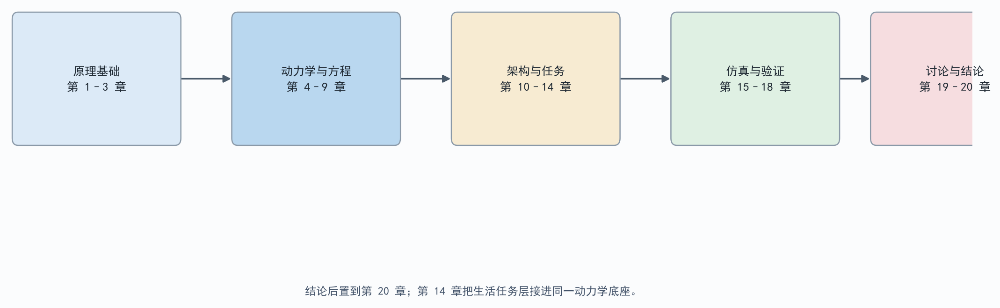{width="5.984251968503937in"
height="1.844537401574803in"}

图 1-1 20 章结构：原理---架构---方程---仿真---结论

## 1.2 本文的组织方式

第 2---3 章定义问题与状态空间；第 4---9
章给出情绪、记忆、人格、念头、目标与演化的方程；第 10---14
章给出动作空间、系统架构、表达层、一致性守护与生活任务层；第 15---18
章给出仿真设置、数值结果、长时稳定与真实场景验证；第 19---20
章讨论边界并收束结论。结论不再夹在中间，统一放到第 20 章。

## 1.3 主要贡献

（1）提出六分量耦合状态
z(t)=\[e,a,θ,ψ,u,g\]，把情绪场、图谱激活、慢参数、人格、念头与目标写在同一组方程里；（2）把"念头越阈"改为"越阈且自我许可"，用
EgoRegulator 解释"为什么现在说"；（3）把 12 条注册行为与 51 个 LLM
工具收进同一张动作表，形成 63
个可解释调用入口；（4）新增生活任务层，把短信快递、排期、提醒、确认、归档做成确定性状态机，并与心理动力学共用同一份状态快照；（5）用
11
组数值检查与真实运行日志验证链路自洽，同时如实标注外部效度边界；（6）在架构层给出会话隔离与记忆作用域：短上下文按会话分桶、长期事实按发送者归并、内核保持单一自我，并用同会话新消息取消旧回复任务消除时序压栈；（7）给出短上下文的闭合机制：语音自述在发送结束后补记入史、指代焦点实体落盘跨重启绑定、打断前抢救半截回复，并指出"整段覆盖写 + 钩子时序"这一框架级落库根因。

# 第2章 问题定义与研究边界

## 2.1 形式化问题

给定用户消息流 X={x1,...,xn}、历史交互记忆 M={(xi,yi,ti)}、以及情境
C（时间、课表、地点、短信、设备状态），要求构建系统
f:(X,M,C)→(Y,e,a,T)，其中 Y 为回复序列，e(t) 为连续情绪状态，a(v,t)
为记忆激活状态，T 为生活任务状态。系统需要同时满足四条约束：

（a）情绪连续性：e(t)
不随单轮对话跳变，跨会话保留残留；（b）记忆可累积：新交互写入图谱，旧记忆按情感强度差异化衰减；（c）行为可解释：每个自发动作可回溯到情绪、记忆、念头或任务来源；（d）记忆零
LLM
成本：检索与衰减不调用大模型。生活任务层再追加一条（e）任务可闭环：发现、确认、排期、提醒、回执、归档六个环节都不丢状态。

*f:(X,M,C)→(Y,e,a,T) （2-1）*

## 2.2 与现有方案的差异

现有方案大多是"强 LLM + Prompt +
向量记忆"：情绪靠提示词维持，记忆靠全量嵌入检索，主动行为靠定时器。它们能生成像样的句子，但很难回答三个问题：为什么此刻主动？为什么是这件事？为什么不是下一次？识海的差异是把动机、情绪、记忆与任务状态做成可读的时序变量，把语言生成降为表达层。

## 2.3 研究边界

本文不宣称系统具备意识或主观体验。心理学概念只作为设计动机的来源，不作为系统模块名：论文中的"快动力学内核、门控调节器、硬安全守护"分别对应情绪/记忆/念头、释放许可、I1--I4
守护；代码与接口不按"本我---自我---超我"命名。当前版本是单用户设计：私聊天然一人一会话，群聊在
unique_session
下把会话键改为"发送者_群号"，不同群友的短上下文互不可见；长期事实记忆以发送者为键，跨会话共享；内核
z(t)
与图谱仍是单一自我，只对用户会话开放读写。多用户各自独立心智、多平台实例与手机独立端仍未实现。仿真只证明数值自洽性与边界行为，不证明线上因果效应；真实场景验证以本机
AstrBot 运行日志与任务状态文件为准。

## 2.4 理论依据及其形式化落点

本文的建模不是从零构造，而是从六个已有理论里各截取一部分，改写成可计算的时序变量。取舍标准不是"理论完整"，而是两条：其一，能否落成不调用大模型的确定性更新（指数衰减、加权求和、阈值比较、计数）；其二，被截取的那部分能否对应到系统中一个可观测的量。以下逐条说明每个理论被用到的部分、形式化落点，以及有意放弃的部分——放弃的部分写清楚，是为了避免把"借用了某个理论的名字"当成"实现了那个理论"。

这一节另有一条总声明，适用于全篇：文中出现的心理学术语（防御、压抑、置换、投射、记忆干扰等）均作**功能类比**使用，其工程定义以第 6 章表 6-1 的触发条件与输出行为为准，不构成本我/自我/超我的模块划分，也不能反过来用于推断用户的心理状态。

### 2.4.1 艾宾浩斯保持率曲线

人类记忆的保持量随时间近似指数下降，而复习与重要、高情绪的事件抬高了初始强度。本文借用的是它的函数形式而非实验结论：保持率写为式（5-3）的 *R(Δt) = exp(−λ·Δt / S)*，λ 是分桶基础衰减率（单位 h⁻¹，见式 5-5），S 是式（5-4）给出的**无量纲**强度倍数；两者配合之后指数里才不出现时间单位。记忆强度写为式（5-4）的三因子乘积 *S = (1 + β·imp)(1 + αE·Ev)(1 + βN·Nrecall)*，三个因子分别对应"这条有多重要"（imp，固结时 LLM 自评）、"当时情绪多重"（E_v，事件冻结时的情绪峰值）、"后来被想起过几次"（N_recall，跨天有效复习计数）。它回答的问题是"这条还记不记得"，服务于天级到月级的条目淘汰与召回排序。

边界有两条。第一，原曲线来自无意义音节的实验室遗忘，本文不主张它精确描述语义记忆。第二，三桶半衰期（事实 15 天 / 事件 30 天 / 核心 90 天，表 5-1）是工程标定值，不是测量值；标定目标是"长期陪伴"而非"快速遗忘"，理由已在 5.3 说明。

### 2.4.2 赫布学习与扩散激活

"同时被激活的连接会增强"，且激活可以沿已有的连接扩散。式（5-6）给出边权增量，式（5-1）给出激活更新：每个节点的新激活 = 自身衰减后的剩余 + 邻居经边权传来的能量。它承担的不是"多一条召回通道"，而是召回的形状——从种子节点沿边扩散，使结果是一串相关的记忆而不是互不相干的 top-k 切片。

边界：扩散只沿已有边进行，全程不调用大模型；本文不对扩散结果做因果承诺，边只表示共现或关联（5.4 已说明代码中不存在可调用的因果判定器）。

### 2.4.3 记忆干扰：前摄抑制与倒摄抑制

新旧记忆会相互压制，也可能被错误拼接。后者在心理学里对应**来源混淆**（source confusion，也称联想干扰），而不是记忆错构——confabulation 特指对记忆空缺的虚构填补，本文不用这个词（理由见 5.4）。这一条在本系统里没有被实现成"再加一个遗忘项"，而是变成**边的准入约束**：门一要求两个节点的发送者相同，否则不连边，属于硬约束而非权重折扣；门二对同一主体 24 小时内、尚未被反复共现确立的边只加 γ·0.2（5.4）。

它的作用是防错构——避免把 A 的事安到 B 身上，而不是提升召回率。边界在 5.4 已写明：门二降低假阳性，不保证因果正确。

### 2.4.4 情绪连续动力学

情绪不是离散标签，每一维有自己的弛豫时间，且各维之间存在互激励。式（4-1）把它写成六维一阶常微分方程，τi 给出各维的消退时长（表 4-1：愤怒 2 小时、恐惧 3 小时、爱意 24 小时），W 描述情绪之间的共鸣。它保证的是情绪跨轮、跨会话保留残留，而不是被单句话重置。

边界：W 采用对称假设以保留梯度流解释，非对称情形未作稳定性证明，只在对称假设下给出数值检查（4.3）。

### 2.4.5 自我调节与防御机制

冲动足够强不等于此刻该表达，中间存在一层调节。本文把它落成式（6-3）的释放许可 $r_{release}>\rho$ 与式（6-4）的阈值抬升：高位放行、低位拦截、抑制条件居中。这层调节的价值在于把"该不该说、以什么策略说"从语言模型手中拿走，交给确定性规则引擎，回答"为什么此刻主动、为什么不是下一次"。

边界：本文只借用"调节"这一功能结构，不采用本我/自我/超我的模块划分，代码与接口均不如此命名（2.3）；表 6-1 的四种机制是可观测的参数动作，不是心理学诊断，也不能反过来用于推断用户的心理状态。

### 2.4.6 大五人格作为慢变量

人格是相对稳定的特质，不因单次事件整体反转。$\psi=(O,C,E,A,N)$（归一到 [0,1]）在系统中是月级慢变量，只调制参数、不直接决定文本，实际只有两处进入更新方程：N 缩放情绪弛豫时间（式 6-1）并切换抑制档位，E 缩放念头累积速率（式 6-2）。它的作用是让单轮对话不能改写人设：一轮负反馈最多改变参数，不能推翻人格。

边界：开放性、尽责性、宜人性目前在状态里保留，但尚未进入更新方程，本文不宣称它们有调制作用；"高外向更主动、高神经质恢复更慢"是参数化的设计选择，未经人群标定。

六个理论的共同落点可以归纳成一句：它们都能写成不含大模型的确定性更新，这正是 2.2 所说"把动机、情绪、记忆做成可读时序变量"的技术前提。反过来，凡是必须调用大模型才能判定的量——语义相似、重要度、因果——本文都显式标注为代理指标，而不是理论结论。

# 第3章 状态空间与时间尺度

## 3.1 六分量状态

系统状态由六个分量构成。快状态承载"此刻的心情与记忆"，慢状态承载"长期的性格与目标"，念头与任务状态负责"是否行动、行动到哪一步"。

*z(t)=\[e(t)∈R6, a(v,t)∈R\|V\|, θ(t)∈Rd, ψ∈R5, u(t)∈R, g(t)∈R4\]
（3-1）*

表 3-1 状态分量与时间尺度

  ------------------------------------------------------------------------------------------------------
      **分量**      **含义**                                         **取值范围**      **时间尺度**
  ----------------- ------------------------------------------------ ----------------- -----------------
        e(t)        六维情绪场：happy/sad/angry/fear/love/surprise   \[0,1\]           小时级

       a(v,t)       图谱节点激活                                     \[0,1\]           小时---天级

        θ(t)        慢参数：阈值、衰减、边先验                       实数              天---周级

          ψ         大五人格 (O,C,E,A,N)                             \[0,1\]           月级

        u(t)        念头强度                                         \[0,3\]           小时级

        g(t)        关系/记忆/自我/回避四目标                        \[0,1\]           天---周级
  ------------------------------------------------------------------------------------------------------

## 3.2 快慢分层

快状态每轮更新，慢状态按天或按周更新，人格按月漂移。三层时间尺度分开的好处是：单轮对话不会把人格带偏，长期反馈也不会被一次情绪淹没。图
3-1 给出六个分量之间的五条回路。

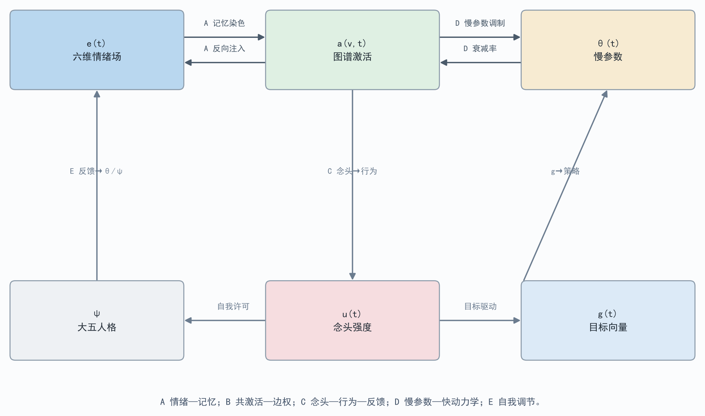{width="5.984251968503937in"
height="3.536149387576553in"}

图 3-1 六个状态分量与五条耦合回路

## 3.3 量纲与稳定性

情绪采用小时为时间单位，弛豫时间 τ 均大于 0.5 h，显式欧拉更新满足
\|1-1/τ\|\<1，不会数值振荡。念头 u(t) 是累积量，上界 3.0
是"强度上界"，不是变化率上界；阈值 2.10 与 u(t)
同量纲。任务时间用绝对时间戳，避免跨天漂移。

# 第4章 情绪场动力学

## 4.1 情绪 ODE

每一维情绪独立弛豫，同时受外部刺激、内部记忆刺激与情绪互激励影响。

*τi·dei/dt = -ei + κ·\[sext,i + sint,i\] + η·ΣjWijej （4-1）*

τ_i 是第 i 维情绪的弛豫时间；-e_i 是自然衰减；s_ext
来自用户输入或语音情绪；s_int 来自被召回的记忆节点；W 是 6×6
情绪互激励矩阵，采用对称假设以保留梯度流解释。

这里必须先交代这组方程管到哪一步：式（4-1）只描述"情绪怎么变"，不描述"情绪怎么变成一句话"。情绪要经过念头与阈值两道接口才影响行为——念头 u(t) 的累积速率由兴趣、时机与情绪状态共同决定（式 7-1），此刻是否开口由 u(t) 与有效阈值 eff_thr 的比较决定（式 7-2）。情绪在这条链条上的位置是"改变 u 的增速"与"参与阈值抬升"，不是直接触发发送。因此答辩里最常被问的"情绪变了之后她怎么决定要不要说话"，答案在式（7-1）与（7-2）而不在式（4-1）。反过来也要纠正一种常见写法：把阈值写成 du/dt 里的减项（τ_u·du/dt = −u + g(e,a) − θ）是错的，本系统的 u 没有这一项，θ 是比较对象，不进入累积方程。

表 4-1 情绪弛豫时间与工程含义

  ----------------------------------------------------------------------------
         **维度**         **τ（小时）**           **工程含义**
  ----------------------- ----------------------- ----------------------------
           happy          6                       开心退得较快，避免一直亢奋

            sad           12                      低落有残留，但不跨周

           angry          2                       愤怒最短，避免累积成冲突

           fear           3                       恐惧中等，给安全感留窗口

           love           24                      亲密感最长，跨天保持

         surprise         1                       惊讶最短，避免噪声
  ----------------------------------------------------------------------------

## 4.2 记忆对情绪的染色

内部刺激 s_int,i=Σ a(v,t)·E_v,i，其中 E_v,i 是节点 v 在第 i
维情绪上的标签强度。被召回的高情感节点会给当前心情"染色"：想起往事，往事又影响当下。该式与第
5 章扩散激活共用同一份 a(v,t)，不需要额外检索。

## 4.3 稳定性与边界

当外部刺激为 0 时，e(t) 按指数回到 0；当刺激持续饱和时，e(t) 被 W 与 κ
限制在 \[0,1\] 内。本文不对 W
的非对称情形做稳定性证明，只在对称假设下给出数值检查；这一限制在第 19
章如实标注。

# 第5章 记忆图谱：扩散、衰减与 Hebbian

## 5.1 为什么不用扁平向量库

陪伴场景需要的不是"相似段落"，而是"这条记忆和谁一起被想起、想起后情绪怎么变"。扁平向量库只返回
top-k
相似项，无法表达共激活、边权与情感衰减。识海用神经图谱：节点是事实、情绪、事件、语录、高亮，边是共现或因果关系。

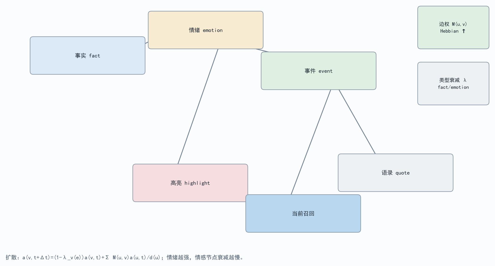{width="5.984251968503937in"
height="3.2198807961504814in"}

图 5-1 神经图谱的扩散激活与双衰减

## 5.2 扩散激活

每个节点的激活值 = 自身衰减后的剩余 + 邻居通过边权传来的能量。

*a(v,t+Δt) = (1-λv(e))·a(v,t) + Σu∈N(v) M(u,v)·a(u,t)/d(u) （5-1）*

N(v) 是指向 v 的邻居集合，M(u,v) 是边权，d(u)
是出度。扩散只沿已有边进行，不调用
LLM；召回结果只把节点摘要送进意图包，不把全文塞进提示词。

式 5-1 写作离散形式便于阅读，仿真与实现里衰减项用精确指数 exp(−λv·Δt) 代替 (1−λv·Δt)：后者在步长变化时会系统性漂移，同一组参数换个步长曲线就变形（§3.3）。

## 5.3 两套衰减：图谱节点的情绪调制，记忆库的保持率曲线

系统里有两种"忘记"，物理含义不同，不能共用一个衰减常数。

第一套是**图谱节点激活** a(v,t)：它是"此刻这条记忆有多亮"，秒级到小时级。它的衰减率受当前主导情绪与节点情感强度共同调制：

*λv(e) = λtype / (1 + α·edom·Ev) （5-2）*

λ_type 由节点类型决定（fact=0.1，emotion=0.01，event=0.05，highlight=0.005）；α=3.0；e_dom=max(e(t))。物理含义：开心时美好记忆衰减更慢，低落时负向记忆保留更久——情绪反向调制记忆，而不是记忆单向决定情绪。

第二套是**记忆库条目的保持率**：事实与事件条目回答的是"这条东西还记不记得"，天级到月级。它不再用"每步乘一个衰减系数"，而是艾宾浩斯保持率曲线：

*R(Δt) = exp(−λ·Δt / S) （5-3）*

R∈(0,1] 是保持率，Δt 以小时计，λ 是该桶的基础衰减率（单位 h⁻¹，见式 5-5）。这里必须把量纲写死：S 是三因子相乘得到的**无量纲强度倍数**，不是时间；只有 λ 带时间单位，指数里才不会冒出"小时"。早期稿写作 R=exp(−Δt/S)，字面上 Δt/S 的量纲就是小时，是错的；下文式（5-5）的 λ_eff = λ/S 才是与式（5-3）自洽的形式。S 由三个因子相乘决定：

*S = (1 + β·imp)·(1 + αE·Ev)·(1 + βN·Nrecall) （5-4）*

β=2.0 是重要度系数（imp 为固结时 LLM 自评的 0–1 重要度，见 5.6）；α_E=2.0、E_v 是事件冻结时的情绪峰值（事实层没有独立情绪字段，此处退化为 1）；β_N=1.5、N_recall 是"跨天有效复习次数"，上限 12（见 5.8）。

换算成衰减率就是 λ_eff = λ/S，其中基础衰减率按类型分桶：

*λ = ln2 / (T½·24) （5-5）*

T½ 是各桶的基础半衰期，单位为天。三桶标定见表 5-1。

表 5-1 记忆库的分桶半衰期与"温和档"理由

  -----------------------------------------------------------------------
   **桶**    **T½（天）**  **λ（h⁻¹）**   **标定理由**
  ---------- ------------- -------------- -------------------------------
   事实 fact       15        1.93×10⁻³     具体事实半个月不提就该淡；再
                                          短就是短期工作记忆

   事件 event      30        9.63×10⁻⁴     事件带情境，比纯事实更值得
                                          留，一个月是"还记得那天"的
                                          量级

   核心 core       90        3.21×10⁻⁴     身份、承诺、关系锚点：三个月
                                          不提也仍在，但不再是永久
  -----------------------------------------------------------------------

这个标定是"长期陪伴"而不是"阿尔茨海默"：如果事实半衰期取 3 天，上周末说的重要事这周三就全忘了。反过来，纯常数衰减也有问题——所有记忆同时同速淡出，说不清"为什么这条记得、那条忘了"。分桶加 S 的组合让差异来自三件可解释的事：这条有多重要（imp）、当时情绪多重（E_v）、后来被想起过几次（N_recall）。

## 5.4 Hebbian 边权：两道门防来源混淆

两个节点在同一窗口内被同时点亮，边权增强；夜间梦境固化时修剪弱边。

*M(u,v) ← M(u,v) + γ·𝟙[a(u)>θact]·𝟙[a(v)>θact] （5-6）*

朴素的"一起亮就连边"会造成**来源混淆**（source confusion，也称联想干扰 associative interference）：前摄抑制与倒摄抑制说明，新记忆会干扰旧记忆，旧记忆也会压制新记忆。这里不采用"记忆错构（confabulation）"这个说法——confabulation 在心理学里特指对记忆空缺的虚构填补（多见于神经损伤病例），不是"把两条真实记忆错误连边"，套用属于概念位移。如果两个事件节点时间贴得很近但属于不同主体（"用户抱怨的 A"与"机器人自己说的 B"），一旦连边，它们就会在后续召回里被拼成一句"我记错了"。因此实现里加了两道门：

**门一，跨主体硬门**：`sender_u != sender_v` 直接不连。这是硬约束，不是权重折扣。

**门二，时间邻近惩罚**：同一主体、两个节点创建时间相差 24h 以内，且这条边还没被反复共现确立过（共现次数 <3）时，本次只加 γ·0.2。碰巧在同一场对话里被一起提起的两件事（"点外卖"和"下雨了"）不该长成强关联；只有跨过更长时间窗、被多次共现的边，才算真正的关联。

这两个数的来源需要交代：24h 与 0.2 都是先验设定值，尚未用日志中共现间隔的分位分布做过标定，性质与表 5-1 的三桶半衰期相同——工程取值，不是测量结果。这一点在第 19 章如实标注。

需要说明的是，代码里没有可调用的因果判定器（is_causal 无处可取），"共现次数"只是因果关系的代理指标。因此门二做的是**降低假阳性**，不保证因果正确——这是本章的方法论边界，不是实现细节。

## 5.5 三层融合与 quote 隔离

记忆分三层：事实层（可核验）、情绪层（主观感受）、关系层（谁和谁、承诺与边界）。三层共用图谱，但召回时按来源打标；语录（quote）单独隔离，不参与事实断言，避免把"她说过的一句气话"当成长期事实。该隔离与第 13 章的一致性守护共用同一套来源标签。

类型分层之外，记忆还有作用域：事实层按发送者归并，同一人跨群、跨私聊共享同一组事实；情绪层与图谱激活属于单一自我，只有与用户的一对一会话写入；会话短上下文按会话串（unified_msg_origin）分桶，不跨人拼接。类型隔离回答"这句话能不能当事实"，作用域隔离回答"这条事实属于谁"。两者共同保证：换一个会话，长期事实还能接上；换一个人，不会把别人的话当成自己的。

## 5.6 重要度自评：让模型凭感受定轻重

S 公式里最重要的因子是 imp，而 imp 不能由代码里的关键词表打分——"八点离散考试"和"中午吃了碗面"在词频上几乎一样平，在关系里的重量差十倍。因此 imp 交给固结阶段的一次 LLM 调用自评：

*imp = round(LLM(dialogue | prompt), 1)，imp∈[0.1, 1.0] （5-7）*

打分口径写死在提示词里，分四档：0.9–1.0 定义关系、承诺、身份、极重情绪；0.6–0.8 长期有效的偏好、习惯、目标、重要事实；0.3–0.5 值得记但会过时的具体事；0.1–0.2 一次性流水细节。模型同时输出事件摘要、情绪标签与事实三元组，一次调用产出全部固结结果，不额外增加轮次。

工程上有一个必须显式化的坑：**按 provider id 指定模型却解析不到时，框架会静默回落到会话默认模型**。这意味着"配了 A 模型、实际跑 B 模型"在日志里完全看不出来，只能看到 imp 长期都是同一个值。因此代码在启动自检里打印一行：

    [memoryv2] 固结打分模型 aliyun_bailian/deepseek-v4.1-flash-1017：已注册

配了 id 但未注册时，同一行会写"未注册→会回落会话默认"。这条日志是本节所有数字可信的前提。

区分度用三段强度递增的对话实测（真提示词、真 provider）：日常闲聊 imp=0.4、离散考试 imp=0.9、"你只是个记不住事的 AI"那类情绪痛 imp=0.8，三段 JSON 全部解析成功。存量 452 条事实按同一口径批量重评后，imp 从"85.5% 挤在 0.2"变成九档分布（0.1×16、0.2×67、0.3×86、0.4×54、0.5×38、0.6×57、0.7×46、0.8×40、0.9×48），平均 0.27→0.49。分桶衰减从此对存量与新数据同样生效。

## 5.7 时序注入：三档时间线，与相关性检索分块

只靠语义相关度召回，日期这一维是取不到的：实测 33 句日常问法里，与历史事件文本有字面重合的只有 6 句，含时间/回忆线索词的 5 句；而"你还记得昨晚说的吗"这类句子里只有时间词、没有任何字面重合。纯语义通道天生召不回"11 月 8 日考试"——这正是长期运行后注入里"只剩日记"的成因。

因此注入拆成两个独立块：**【你记得的旧事】** 按相关度排序，来自事实层与事件层检索，名额 fact_top_n + event_top_n；**【这些天的片段】** 按日期排序，不看相关度，是"日子的底子"。后者按三档分配名额与字数：

表 5-2 时间线三档（名额按最大余数法分配）

  -----------------------------------------------------------------------
     **档**     **天数上界**  **系数**  **单条字数**  **8 条时名额**
  -------------- ------------- ---------- -------------- ----------------
     近三天           3          1.00        36            3

     近一周           7          0.85        30            3

     近半月          15          0.70        24            2
  -----------------------------------------------------------------------

越近的档系数越高、字数越宽、名额越多，因为"最近那几天"才是被问起时答得上来的。两块的预算互不侵占：相关块吃 inject_char_budget，时序块单独有 timeline_char_budget（默认 340 字）。跨块去重只在两条记忆的字面重合占比 ≥60% 时生效——早期用"≥3 个二元组"的绝对阈值，会把"11 月 8 日考试"这条误杀（它只跟事实撞两三个词）。实测时序块 239 字、单轮总注入约 500 字，覆盖从 10 天扩到 15 天。

## 5.8 复习计数：两道闸，防"永生记忆"

N_recall 是 S 里唯一能持续增长的因子，也是唯一可以被"刷"的因子：用户天天问一句"吃了吗"，系统天天回"吃了"，这条废话若每次都算复习，S 会无限变大，记忆永不衰减。

因此每次召回计分前过两道闸：

*ΔN = 1 iff overlap(recall, item) ≥ 2 且 now − last_recall_ts ≥ 24h （5-8）*

闸一要求字面重合至少 2 个二元组——只语义相近、没有实体重合的顺嘴话不算复习；闸二要求距上次计分超过 24 小时——同一轮里连问三次只算一次。实测：同一句"离散考得怎么样"连问 3 次，recalls 只从 0 变 1；无重合的"哈哈哈"保持 0。这两道闸与 N_recall 上限 12 一起，把"复习效应"限制在"真的隔了一段时间还记得"这件事上，而不是"被反复提及"。

## 5.9 3/7/15 天体检日：不是每天清扫

有了 R 与 S，归档就不该每天跑一遍全库。实现里把 3/7/15 天设成三个体检日，每天最多扫一次（`_last_sweep` 隔 86400 秒才允许下一次），三个时点各自带判据：

*归档 iff age ≥ 15（硬淘汰）∨(7 ≤ age < 8 ∧ R < 0.30)∨(3 ≤ age < 4 ∧ R < 0.35) （5-9）*

前提是"低价值"：事件降级且无摘要，或 imp ≤ 0.2 且激活 a < 0.15。归档不是删除——条目只从可注入池移到 `event_archive.json`，原文一字不改，随时可以捞回来。

这里有一个必须写明的实测结论：**在温和档的分桶半衰期下，3 天与 7 天两个窗口的 R 阈值几乎不可能被触发**。事实桶 15 天半衰期、imp=0.2 时 S=1.4，有效半衰期 21 天，3 天后 R≈0.91，远高于 0.35。真正起作用的是 15 天硬淘汰。仿真里 400 条混合库推进 30 天，3 天档与 7 天档命中均为 0，15 天档命中 192 条（图 B-15）。这不是实现失效，而是"温和档"的必然结果：想靠 R 判据在 3 天内清掉东西，只能把半衰期压到 3 天量级，而那正是本文明确拒绝的短期工作记忆档位。

## 5.10 逐字归档与原文锚点：让窗口外也能取回原话

### 5.10.1 问题：摘要链路之外，逐字原文是断的

前述事实层与情景层保存的都是**结构化摘要**而非逐字原文。逐字内容在系统中实际存在三处但未打通：早期独立记忆插件的 SQLite 库保存了 1,173 条逐字消息，但该插件已停用、接不进当前回忆链路；核心库的会话表只存当前滑动窗口快照，截断丢轮时被丢内容也从快照消失；而本节的 fact / event 仅是摘要。其结果是：窗口内（约 50 轮）有完整原话，窗口外只剩摘要，且停用插件之后的新对话逐字归档处于断档状态。

### 5.10.2 设计：独立逐字层 + 原文锚点 + 按需检索

为在不增加每轮固定成本、不破坏前缀缓存（见 18.6）的前提下补齐逐字能力，方案不把原文塞进随每轮重写的 JSON，而是新增一个独立的逐字归档层，由三部分组成。

表 5-10 逐字归档层的组成

| 组件 | 职责 | 关键设计 |
|---|---|---|
| 逐字库 `transcript.db` | 每轮 user / assistant 逐字持续归档 | SQLite + FTS5 全文索引，WAL、append-only，单文件、不入版本库 |
| 原文锚点 `transcript_turn_id` | EventItem 关联对应逐字轮 | 只存轮次指针、不复制全文，保持 event_snapshot.json 精简 |
| 工具 `recall_transcript` | 按需检索逐字片段 | 模型主动调用，不常驻前缀，返回片段带预算截断 |

逐字库记录每条消息的时间戳、会话标识、角色、发送者、逐字内容、消息类型（文本 / 语音 / 被打断）、平台消息 id 与轮次 id，并以平台消息 id 去重；FTS5 虚表与主表同步，配合应用层字符二元组处理中文检索。用户消息在观察钩子（已含非 bot、非命令过滤）写入，小满回复在「发送结束后」钩子写入——该钩子取的是**实际发出**的 chain，因此语音的朗读文本、被打断的半截回复都能落库，与 11.6 的上下文闭合共用同一挂载点。

### 5.10.3 与缓存经济性的正交关系

逐字归档的写入是本地数据库操作，不产生任何 API 调用与 token；读取仅发生在 `recall_transcript` 被调用的少数轮次，返回片段计入当轮输入，平均每轮固定成本不变。由于归档内容与锚点都不进入系统提示这一固定前缀，18.6 测得的 98% 缓存命中率不受影响；新增工具的 schema 属于工具定义、本就位于被缓存的固定前缀内，其增量极小。这体现了一条设计原则：**长期可检索的原文应当与每轮常驻的上下文分离**——前者追求完整与可回溯，后者追求稳定与低成本。

### 5.10.4 历史迁移与边界

早期独立记忆插件库中的 1,173 条逐字消息通过一次性迁移脚本导入逐字库，按内容哈希与消息 id 去重、幂等可重复运行，并在迁移后校验条数、时间范围与抽样检索。边界需如实说明：语音归档的是 TTS 实际朗读文本而非音频，图片归档的是路径与用户说明而非图像内容；断档期间仍在滑动窗口内的内容可从核心会话表补回，已出窗口的逐字内容无法恢复、只能依赖摘要。

# 第6章 人格与自我调节

## 6.1 大五人格作为慢变量

ψ=(O,C,E,A,N) 不是初始化常量，而是月级慢变量，取值统一归一化到 [0,1]。它在系统中只调制参数、不直接决定文本，实际作用点可逐处核对。

一是情绪弛豫时间按神经质 N 缩放：

*τi = τi,0·(1 + N) （6-1）*

N∈[0,1] 时弛豫时间最多拉长一倍：N 越高，情绪残留越久——"恢复得慢"归这一条。这里要防一个常见误用：若把 N 当成问卷原始分（1–5）代入，会算出 2τ₀~6τ₀，那是量纲误用；本文的 ψ 始终是归一分。

二是念头累积速率按外向性 E 缩放：

*du/dt = base_rate·(0.5 + 0.5·E)·I·T·M （6-2）*

E∈[0,1] 时系数落在 0.5~1.0 之间，E 越高念头涨得越快——"更主动找人说话"归这一条，且它与弛豫时间无关。必须在这里纠正一种常见误写：把主动开口写成概率 *p_initiate = p₀·E* 是不成立的——E 若按 1–5 分代入会得出大于 1 的概率，且概率语义与"累积到阈值才发送"的机制不符；本系统调制的是累积速率，不是发送概率，系数有界。

三是抑制档位按 N 分段切换：N ≥ 0.6 时改用另一档更严的抑制下界，否则取默认值。这是分段规则而非连续函数，因此本文只陈述切换点，不宣称它是光滑调制。

由此，"高外向恢复得更快"这句话在本文不成立，应改为"高外向更主动、高神经质恢复更慢"：两个方向分别由 E 与 N 承担，不共用一条通道。开放性 O、尽责性 C、宜人性 A 目前在状态里保留但尚未进入更新方程，本文不宣称它们有调制作用。ψ 只给先验，后续由交互经验修正（见 9.3），单轮反馈不能推翻它。

## 6.2 EgoRegulator：越阈不等于发送

念头越阈只说明"冲动足够强"，不说明"现在该说"。EgoRegulator
是确定性规则引擎，不调用 LLM，输出释放许可 r_release 与延迟 r_delay：

*u \> FIRE_THRESHOLD 且 rrelease \> ρ ⇒ 发送 （6-3）*

*FIRE_THRESHOLD ← FIRE_THRESHOLD + δ·rdelay （6-4）*

r_release 的规则是"高位放行、低位拦截、抑制条件居中"：u
顶到上界视为真实表达意愿，优先放行；u
低于半阈值视为气话，直接拦截；冲突、强负反馈、连续冷落落在中间，转入延迟或替代行为。延迟只抬门槛，不改变
u 的累积速率。

表 6-1 防御机制与作用对象

  -----------------------------------------------------------------------------------------------
      **机制**      **触发条件**                   **作用对象**      **工程落点**
  ----------------- ------------------------------ ----------------- ----------------------------
       合理化       反馈中性但念头徘徊在门槛附近   表达策略          改变叙事角度，不改原始情绪

        压抑        连续冷落或强负反馈             阈值、召回偏置    阈值上升，念头积累变慢

        投射        用户意图置信度低               外部刺激权重      下调 s_ext 置信度

        置换        抑制期内越阈                   行为空间          转入写日记/发动态/梦境固化
  -----------------------------------------------------------------------------------------------

## 6.3 与 LLM 审议层的边界

EgoRegulator 在前，回答"能不能说、以什么策略说"；LLM
在后，回答"具体怎么说"。LLM 的输入只有意图包，不进入 Ego 的输入；LLM
的输出不回写 e(t) 与 a(v,t)，只能通过 r_feedback
影响下一周期的慢参数。一句话：慢参数与释放条件归 Ego，语言表达归
LLM，快状态两者都不能直接写。

# 第7章 念头、阈值与由头锚点

## 7.1 念头累积

念头不是定时器，是一个可积累的量。兴趣、时机与情绪状态共同决定累积速率：

*du/dt = K·(w1I + w2T + w3M + w4I·T·M) （7-1）*

I 为兴趣度（情绪与记忆共同决定），T 为时间适配度（作息模型），M
为情绪状态因子。I、T、M 归一化到 \[0,1\]，Σw=1，K 为标定增益。典型工况下
du/dt≈0.111/h，念头从 0 攒到 2.10 需要数小时，而不是每轮都触发。

## 7.2 有效阈值

有效阈值由自适应项、延迟项与上限共同决定：

*eff_thr = min(θadapt + δ·rdelay, URGE_CEILING-0.01) （7-2）*

连续未回复会抬高门槛（STREAK_GATE_STEP=0.2），刚聊过会清零；门槛有上限，避免"越冷落越不敢说"的死锁。该式与
6.2 的释放许可串联，先算门槛，再算许可。

## 7.3 由头锚点与可识别性

主动开口不能只有"我想你了"，必须带一个可识别由头：一条记忆节点、一个承诺、一次未完成的事、或一个任务卡。发送前做两道校验：锚点必须有节点绑定与内容摘要；空泛锚点不放行。这样"为什么是这件事"可以回答，也避免把随机生成当成意愿。

## 7.4 重复不等于退化

同一首歌可以在不同由头下被再次选择。判定重复的不是曲目，而是意愿锚点：如果这次是"想起你上次说喜欢"，下次是"今天放学路上突然想唱"，两次都成立。代码只记录"歌名｜这次想唱它的由头"，不强制换歌；把重复曲目当成
bug，会把"她自己的意愿"误判成模板。

# 第8章 目标向量与策略选择

## 8.1 四维目标

g(t)=\[g_relation,g_memory,g_self,g_avoid\]
分别对应关系、记忆、自我与回避。目标不是手写常量：长期得不到满足会衰减，反复冲突会上升。它比
θ 慢、比 ψ 快，处在"周级"时间尺度。

## 8.2 策略打分

动作选择不是端到端黑箱，而是可解释打分：

*π(e,a,ψ,u,g) = argmaxx \[Q(e,a,x) + β·Σigi·φi(x)\] （8-1）*

Q 是启发式打分，不是在线学习的价值函数：Q=Σ w_k f_k，f_k
为情绪一致性、记忆相关度、目标贡献、工具可用性、重复惩罚五个手工特征，w_k
为固定权重。本文不做贝尔曼备份或时序差分；在线学习只发生在 θ 与 ψ 上。

## 8.3 目标演化

g
的更新由"当前策略能带来的目标收益"和"长期观测到的偏好满足度"共同驱动。正反馈让对应分量接近
1，强负反馈接近
0；某次交互只累加到它实际服务的那个分量，避免一次聊天同时抬高四个目标。

# 第9章 自适应演化与参数变更

## 9.1 慢参数在线学习

θ 包含触发阈值、衰减率、边先验等。它按总损失的梯度更新：

*θt+1 ← θt - ηadapt·∂Ltotal/∂θ （9-1）*

L_total
由漏出损失、情感连续性损失、记忆质量损失、工具成功率损失与用户反馈适配损失加权组成。用户反馈映射为
\[0,1\] 的连续信号，而不是 0/1
二值；工具成功率也用连续成功率。这样梯度合法，不会因为一次"已读不回"把参数打到极端。

## 9.2 人格漂移

ψ 的学习率远小于 θ，设计上只做月级漂移。L_ψ
取统计偏离的平方和：主动频率对应 E，冲突率对应 A，恐惧残留对应
N，任务完成率对应 C，新话题占比对应 O。实现层的统计窗口为 7 天（168
h），样本不足 20 次交互的维度权重置 0，避免小样本把人格带偏。

## 9.3 三层慢演化

演化分三层：L1 调行为参数（冷却、长度、语气），L2 调探索上限 ε_max，L3
只写叙事观察（"最近更愿意主动唱歌"）。三层都只写 behavior_evolution.json
overlay，不直接改 behaviors.json；24
小时评估一次，样本不足不动，回滚只需删除 overlay 并重启。

表 9-1 当前运行参数、默认值与取值依据

  --------------------------------------------------------------------------------------
       **参数**       **默认值**        **取值依据**                   **可调**
  ------------------- ----------------- ------------------------------ -----------------
      platform_id     qq                工程接口契约：平台实例名       否

    fire_threshold    2.10              标定实验：念头累积仿真         是

     urge_ceiling     3.00              工程安全边界：强度截断         否

        ego_rho       0.50              经验值：高位放行/低位拦截      是

     threshold_max    3.50              工程安全边界：防死锁上限       是

     tick_seconds     60                工程时序：分钟级状态推进       是

   watcher_interval   20                工程时序：20 秒轮询            是

    action_cooldown   1800              经验值：防刷屏                 是

   evolution_enabled  true              功能开关：默认开启，可回滚     是

   evolution_window   7 天（168 h）     工程时序：慢演化统计窗口       是

     task_context     16:00/18:00/8     用户情境配置：下课/关门/步行   是
  --------------------------------------------------------------------------------------

表中"标定实验"指第 15---16
章的数值检查；"工程安全边界"是防止积分越界或阈值死锁的硬上限，不得为提高触发率随意放大；"经验值"可按用户作息调整。凡标"可调"的参数都由配置读取，修改后经一次
tick 生效。

# 第10章 动作空间：行为与工具

## 10.1 统一动作表

动作空间由两部分组成：12 条注册行为（由看门狗按状态与策略触发）与 51 个
LLM 工具（由对话或行为执行器调用）。两者共用一张动作表，每条都有
id、标签、前置条件、冷却与执行函数。当前总入口为 12+51=63。

表 10-1 动作空间分层计数（合计 63）

  --------------------------------------------------------------------------------------------------------------
         **分层**         **数量**                **代表入口**
  ----------------------- ----------------------- --------------------------------------------------------------
       条件触发行为       12                      主动问候、关心、回忆、承诺跟进、唱歌、画画、说说、日记、梦境

         生活任务         5                       task_list / task_confirm / task_done / task_ignore /
                                                  task_set_context

         短信快递         1                       get_recent_express

         路线出行         1                       travel_plan

         商品检索         1                       product_search

          QQ 社交         8                       说说、评论、点赞、删除、转发、资料

          QQ 资料         3                       改昵称、改签名、换头像

         转述投诉         2                       告状、传话

         媒体生成         7                       画图、唱歌、翻唱、语音、表情

           日记           2                       写日记、读日记

         信息互动         4                       天气梗、戳一戳、用户信息、插件列表

           记忆           1                       shihai_recall

       调参诊断管理       16                      状态、注入、调参、行为开关、手动触发
  --------------------------------------------------------------------------------------------------------------

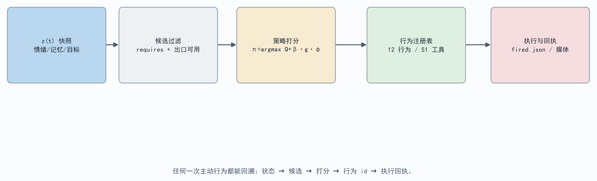{width="5.984251968503937in"
height="1.8246412948381452in"}

图 10-1 从状态到行为的可解释选择链

## 10.2 候选过滤与执行

候选先过前置条件：需要画图能力才能选画画，需要 RVC 才能选翻唱，需要 QQ
平台才能选说说。过滤后再打分，避免"选了但执行不了"。执行器返回
ok/error、文本或媒体路径，并把这次行为写入
fired.json；失败不回写情绪，只记一条警告。

执行器还要处理"旧回复压新消息"：同一会话串的新请求到达时，取消该会话尚未完成的旧回复任务；取消以会话串为键，只作用于同一会话，不误伤其他会话。该规则是运行时时序约束，不改变
z(t) 与行为选择。

本文不使用"涌现行为"作为字段名。主动行为是可复核的条件触发：u(t) \>
eff_thr，r_release \> ρ，候选 requires
满足，冷却已过，且由头锚点通过校验；任一条件不成立就不触发。日志以
behavior_id 与 trigger_trace
逐项记录这些条件，避免把"看起来像自己想说"误写成"涌现"。

## 10.3 行为不是定时器

12 条行为没有"每天 9 点问候"这种
cron；它们只在念头越阈、自我许可、候选可用三者同时成立时被选中。生活任务层是例外：快递提醒走确定性通道，不经过
u(t) 阈值，因为"驿站 18:00 关门"是硬约束，不该被情绪概率拖延。

# 第11章 系统架构与实现

## 11.1 分层架构

系统分五层：感知入口、动力学内核、行为与任务、表达与平台、守护。感知层收
QQ 消息、短信、课表/地图/天气；内核层持有
z(t)；行为层做候选与执行；表达层只生成语言与媒体；守护层做来源、断言与时序校验。

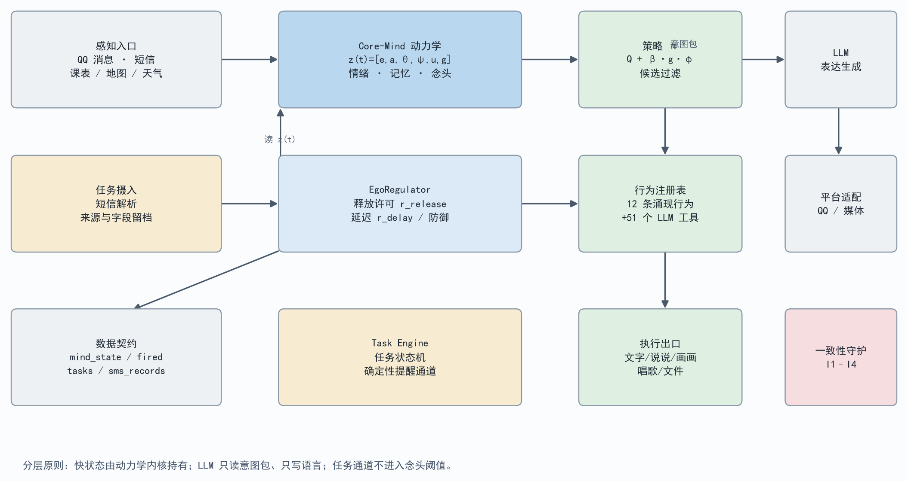{width="5.984251968503937in"
height="3.1764752843394577in"}

图 11-1 识海系统分层架构

## 11.2 数据契约

快状态写 mind_state.json，行为回执写 shihai_fired.json，图谱写
shihai_graph.json，任务写 tasks.json / task_events.jsonl /
task_context.json，短信原文写
sms_records.json。每份文件都有单一写入者：内核写状态，行为层写回执，任务层写任务，短信插件写记录。跨层只读快照，不互相改文件。长期事实记忆写
memory.json，以 users\[sender\] 归并；会话历史按 unified_msg_origin
分桶，私聊一人一会话，群聊在 unique_session 下为"发送者_群号"。

## 11.3 会话隔离与记忆作用域

会话隔离不是把系统拆成多个心智，而是给同一个自我划分三种作用域。会话层决定"这句话属于哪个对话"，记忆层决定"这条事实属于谁"，自我层决定"这套情绪与图谱是谁的"。三层各自有键，不能互相替代。

表 11-1 会话、记忆与自我的作用域

  -------------------------------------------------------------------------------------------------------------------
     **作用域**     **键**               **存什么**                     **隔离规则**
  ----------------- -------------------- ------------------------------ ---------------------------------------------
     会话上下文     unified_msg_origin   最近对话、摘要、会话状态       私聊按人；群聊按"发送者_群号"；不跨会话拼接

    长期事实记忆    sender               事实、昵称、稳定偏好           同一人跨群/私聊共享；不同人分开

      自我状态      单例 z(t) 与图谱     情绪场、图谱激活、念头、目标   只有用户会话读写；非用户不接收
                                                                        z(t)、图谱激活与意图包
  -------------------------------------------------------------------------------------------------------------------

这样处理之后，"她记得你"与"她不会把群友的话当成你的"可以同时成立。会话隔离由框架的
unique_session 完成；记忆归并由长期记忆模块按 sender
完成；自我边界由两个默认开启的门控完成：owner_only_perception
拦住非用户消息写入图谱，intent_owner_only 拦住非用户会话接收 z(t)
与意图包。三者都是访问控制，不是把心智复制多份。

在上述作用域划分之上，多会话机制还需处理**并发与归档隔离**两个工程问题。

其一，并发回复以会话为单位独立管理。系统为每个 `unified_msg_origin` 维护各自的回复任务句柄：同一会话内新消息到达时，可取消该会话尚未完成的旧回复并先抢救半截内容（见 11.6），而不同会话的回复任务互不阻塞、互不取消。指代焦点等会话级状态也按会话键单独落盘，重启后仍能对上「她 / 他」指的是谁，不会把 A 会话的焦点泄漏到 B 会话。

其二，逐字归档按会话隔离、长期记忆按人归并。5.10 的逐字库为每条记录保存 `origin` 字段，原话检索默认限定在当前会话范围内，避免跨会话串台；而事实层仍按 `sender` 归并，使同一个人在私聊与不同群聊中的稳定身份、偏好保持一致。于是「同一人跨会话记忆连贯」与「不同会话的上下文与原话互不干扰」可以同时成立：共享的是属于这个人的长期事实，隔离的是属于具体对话的上下文、焦点与逐字记录。

## 11.4 与平台解耦

平台会话串统一为
qq:FriendMessage:\<owner\>，不再把协议端名字写进业务代码。发送通过
ProactiveSender 走
context.send_message，文本、图片、文件、语音各有独立出口；换平台只改适配器，不改动力学。

## 11.5 多模态感知闭环

图片、语音、表情、戳一戳都先转成文本或标签，再进入感知层；媒体生成结果回到表达层，不直接写情绪。这样"看见一张图"可以影响心情，但不会让图片字节污染状态。

## 11.6 上下文闭合：自述入史、指代焦点与打断抢救

长期记忆解决"她记得三个月前的事"，短上下文解决"她记得上一句自己在说什么"。后者在早期实现里有三处结构性断裂，且共同特征相同：**发出去的东西说了，但历史里一个字都没有**。

实测口径取自一个真实会话（121 条消息）：assistant 带正文 45 条、只有 think 块无正文 11 条、空 1 条、user 51 条、tool 13 条。全库检索"线头""完整一点"只命中 user 侧那条提问，assistant 侧那条 10 秒语音的正文一条都不存在。因此"这句我不记得自己说过，你在哪儿看到的"不是语气问题，而是历史里真的没有这句；同一统计里那 11 条 think-only 还说明，丢的不只是语音——工具轮与流式轮的可见回复也在丢。

### 11.6.1 根因：整段覆盖写与钩子时序

框架侧有两条硬事实决定了补记必须挂在哪里。其一，管道在 `_save_to_history` 里用 `update_conversation(..., history=message_to_save)` **整段覆盖**本轮请求的 messages，而不是增量追加；其二，respond 阶段的顺序是"先 `event.send`，后 `call_event_hook(OnAfterMessageSentEvent)`"。二者叠加的后果是：任何在**发送阶段**往历史里追加的行，都会被本轮这次覆盖写抹掉。补记只能发生在**发送结束之后**。

打断逻辑相反，时机本来就是对的：同会话新消息到达时触发的 `OnWaitingLLMRequestEvent` 在 `session_lock_manager.acquire_lock` **之前**被调用，注册语义写明"仅通知、不阻塞"。整晚运行日志里"已取消上一条未完成的回复"出现 0 条，说明多数上下文丢失并非 cancel 造成，而是上面的落库缺陷，加上旧实现只补 user 侧、已生成的半截 assistant 正文一句不留。

### 11.6.2 三处修复

**（一）语音自述入史。** 语音发送时消息链被替换为 `Record`，chain 里不再有文字组件，框架因此没有可存的正文本。修复把它拆成两步：发送前把正文暂存到事件上，发送成功后的 `after_message_sent` 钩子再补一条 assistant 轮，正文前缀标明它是语音：

*history ← history ∪ {（assistant，"（语音）" + text_tts) }，在 send 之后调用 （11-1）*

补记必须去重：同一轮可能既走本地 TTS 出口又走降级群语音出口，若不去重会连写两条。判重不按整句相等，而按四字片段重叠率：

*dup(a,b) = 1 iff |G₄(a) ∩ G₄(b)| / |G₄(a)| ≥ 0.6 （11-2）*

其中 G₄(·) 为句中去掉句首语气标注与空白标点后的四字片段集合。阈值取 0.6 而非 1.0，是因为 TTS 出口略带改写（"发出去啦"一类回执），整句比对会漏判。

**（二）指代焦点绑定。** "给我姐姐说句生日快乐"，下一轮"今天她生日"，她反问"她是谁"。修复不改推断逻辑，只增加一个会话级的焦点槽：从关系称谓词表（姐姐/妹妹/哥哥/弟弟/妈妈/爸爸/室友/同学/老师/女朋友/男朋友/对象/同事/老板/学长/学姐）中取最近一次命中的实体，有效期 6 小时：

*F_t = (entity, t_F)，valid iff now − t_F < 6h （11-3）*

焦点必须**落盘**（`plugin_data/shihai/focus/[md5 前 16 位].json`）。当晚进程因看门狗重启 5 次，任何内存态焦点都会在重启处归零，而"她是谁"恰好问在重启窗口内——这正是它跨会话不成立的原因之一。注入侧只做一件事：当且仅当当前句出现"她/他/它"时，在意图包里追加一行 `【当前焦点】「她」指最近提到的那位：姐姐……别反问"她是谁"`，约 20 token；不出现代词就不加，避免每轮固定开销。

**（三）半截回复抢救。** 取消旧任务前先抢救，而不是先 cancel：把旧回复已经生成的 Plain 文本按"（说到一半被打断）"标签写入历史，再取消任务，最后才注入新请求。次序固定为 merge → cancel → inject，任何一步失败都只记诊断日志、不阻断新回复。这样模型看到的不是"用户突然换话题"，而是"我刚说到一半被打断了"。

三处补记只作用于用户会话键：读改写按 conversation_id 定位、不新建会话，非用户会话不写，与 11.3 的会话隔离一致。

### 11.6.3 验证

离线验证用真实类加 stub 的 conversation_manager：喂"给我姐姐说句生日快乐"后焦点解析为"姐姐"，再喂"今天她生日"仍解析"姐姐"（说明焦点未代词覆盖）；同一句语音正文连写两次，第一次返回 True、第二次被判重（去重生效）。上线验证看启动日志新增的一行：

*[识海行为] 上下文闭合已启用：语音自述入历史 / 指代焦点绑定 / 半截回复抢救*

## 11.7 任务层挂载点

任务层挂在行为看门狗的每轮开头，先摄入短信、发任务卡、推进到期提醒，再走原来的
fire_pending
逻辑。任务层异常被独立捕获，不拖垮行为层；行为层异常也不回滚任务状态。两者共享同一份
state 快照，但写不同文件。

# 第12章 表达层：意图包与人格边界

## 12.1 意图包

意图包 I_t 是内核给 LLM
的唯一输入：一条人设、一句当前意图、一个由头锚点、几条状态断言。它不包含完整情绪向量、不包含图谱全文、不包含任务库。LLM
看到的越少，越不容易把"此刻"编成"一直"。

## 12.2 双信号源

表达层有两个信号源：状态断言（"我现在有点不安"）与由头（"因为你上次说......"）。前者来自
e(t) 与 ψ，后者来自 a(v,t)
或任务卡。两路都必须在意图包里出现，缺一路就退回"普通聊天"，不冒充主动。

## 12.3 语录隔离与断言改写

语录只用于风格参考，不用于事实断言。生成后做一次轻量改写：把"你上次说你要退学"改成"你上次提到过退学的念头"，把绝对判断改成带来源的观察。该改写不调用第二次大模型，用规则与模板完成，避免成本翻倍。

## 12.4 重复与人格一致

同一行为可以重复，但重复必须带新由头；同一人格不能因为一次负反馈就翻脸。表达层只调整语气与长度，不改人格基底；人格漂移由
9.2 的慢变量负责。这样"她今天有点低落"与"她还是她"可以同时成立。

## 12.5 提示词瘦身

提示词只保留三块：人设一句、意图一句、边界一句。历史对话由会话层按需拼接，不把整本记忆塞进系统提示。提示词越短，状态断言越容易被看见，越不容易被长上下文淹没。

# 第13章 一致性守护

## 13.1 四类故障

长期运行最容易出四类故障：F1 时序错乱（把昨天的事说成今天）；F2
记忆错配（把 A 的事安到 B）；F3 人格漂移（一轮对话换一个人）；F4
行动失忆（做了却说没做）。四类都不是"模型不够聪明"，而是状态与表达之间缺少校验。

## 13.2 四不变量

表 13-1 一致性守护的四不变量

  --------------------------------------------------------------------------------------------
        **不变量**        **约束**                                     **检查点**
  ----------------------- -------------------------------------------- -----------------------
          I1 时序         断言的时间不得早于来源时间，也不得晚于当前   生成后、发送前

          I2 来源         事实断言必须能指回节点或原文片段             意图包组装时

        I3 表达归界       人格断言不得越过设定边界                     persona 扫描

        I4 行动记忆       说"做过"必须有 fired 回执                    发送前与发送后
  --------------------------------------------------------------------------------------------

## 13.3 五道防线

第一道在来源侧：没有节点绑定的锚点不进入意图包。第二道在意图包：状态断言与由头必须成对。第三道在生成后：规则扫描绝对化表达与时间词。第四道在发送前：F4
检查 fired
回执。第五道在发送后：把这次行为写回回执，供下一轮校验。五道防线都不调用第二次大模型。

## 13.4 行动记忆

说"我给你唱过了"之前，先读 fired.json；没有对应 action 与
ts，就不说"唱过"，改说"我想给你唱"。这条规则把"语言里的行动"与"真实执行"绑定，避免长期陪伴里最常见的"假装做过"。

## 13.5 上线验证

上线后按四类故障各抽 20
条日志人工核对；发现误报先看来源标签是否缺失，再看断言是否被改写。守护层只读
z(t)，不写快状态；它的输出是"拦下/放行/改写"，不是"改情绪"。

# 第14章 生活任务层：从短信到闭环

## 14.1 任务模型

生活任务层把"短信里的快递"变成一张可追踪的任务卡：来源（短信原文、发送方、时间、命中字段）、任务内容（取件码、驿站、运单号）、情境（下课时间、关门时间、步行分钟）、状态、用户动作。任务卡不是聊天记录，而是状态机的一条记录。

## 14.2 确定性通道

快递提醒不走念头阈值
u(t)。驿站关门是硬约束，情绪低时也不能拖；任务层每轮 tick
直接检查到期任务，按优先级发提醒。

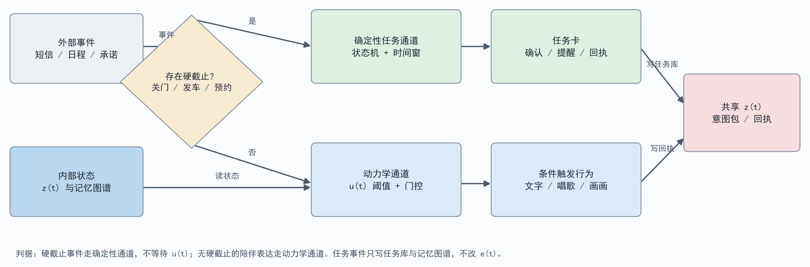{width="5.984251968503937in"
height="1.976788057742782in"}

图 14-1 混合决策通路：确定性任务通道与动力学通道

判据不是"重要/不重要"，而是事件是否带硬截止：关门、发车、预约到期等错过即不可逆的事件走确定性通道，不等待
u(t)；没有硬截止、属于陪伴表达的事件走动力学通道。两条通道共享同一份
z(t) 快照：任务事件写任务库与记忆图谱，但不改
e(t)；动力学通道只把任务摘要当作弱情境刺激。这样既保证时效，也不让任务层退化为独立提醒器。

优先级由紧急度、顺路度、任务价值与打扰成本共同决定：

*priority = w1·urgency + w2·route_fit + w3·value - w4·disruption
（14-1）*

时间窗由下课、步行与关门时间共同决定：

*start = max(now, class_end + walk), end = station_close - buffer
（14-2）*

若 end 已过，任务直接标
expired，并给"今天来不及了，明天再取或回我延后"的替代；不生成一个必然迟到的提醒。

## 14.3 状态机

表 14-1 生活任务状态与迁移

  ------------------------------------------------------------------------------
       **状态**      **含义**               **入口**          **出口**
  ------------------ ---------------------- ----------------- ------------------
   pending_confirm   刚发现，待发卡         短信摄入          awaiting_confirm /
                                                              ignored

   awaiting_confirm  已发卡，等用户确认     任务卡            planned / ignored
                                                              / expired

       planned       已排期，有窗口与理由   确认              reminded /
                                                              deferred / expired

       reminded      已提醒，等回执         到期              done / deferred /
                                                              ignored

         done        已取/已办              回执              archived

       archived      归档，不再提醒         自动              ---

       ignored       忽略，不再提醒         回执              ---

       deferred      延后，窗口重算         回执              planned / expired

       expired       窗口已过               自动              ---
  ------------------------------------------------------------------------------

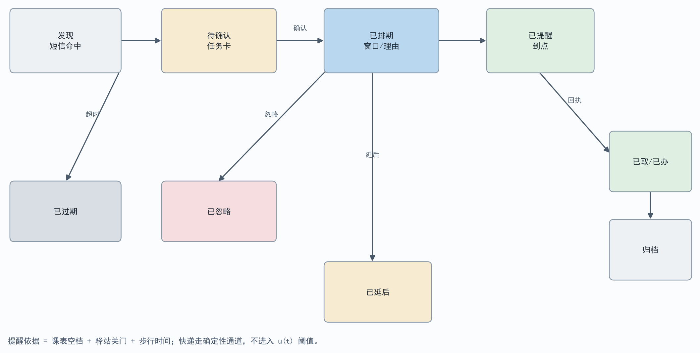{width="5.984251968503937in"
height="3.0246948818897637in"}

图 14-2 生活任务状态机

## 14.4 情境融合与"为什么现在提醒"

任务卡的理由要能说人话：16:00 下课、驿站 18:00 关门、步行 8 分钟，16:10
出发最顺路。理由串由确定性模板生成，不让 LLM
自由发挥"我觉得现在合适"。图 14-3 给出时间窗示例。

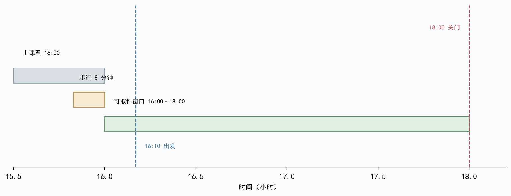{width="5.984251968503937in"
height="2.299610673665792in"}

图 14-3 顺路取件的时间窗示例

## 14.5 代码落地与运行证据

实现落在 behavior/tasks.py：TaskStore 负责 tasks.json
原子写与坏文件不覆盖，TaskEngine
负责摄入、去重、排期、提醒、回执与归档。behavior/main.py 挂载 5 个 LLM
工具（task_list / task_confirm / task_done / task_ignore /
task_set_context），并在看门狗每轮开头先跑任务层。冒烟测试覆盖
ingest、dedupe、plan、remind、archive 五个环节，输出
task_id=tk_8049d7ac68、sent_count=2。

本机运行记录：2026-11-09 22:53:27 的顺丰短信被摄入为任务
tk_c78e0dc512，状态从 pending_confirm 迁到
awaiting_confirm；task_events.jsonl 留有 discovered 与 transition
两条事件。该记录证明"短信→任务卡"在真实 AstrBot
进程里跑通，而不只是单元测试。

## 14.6 隐私与边界

短信原文只存本机，默认保留 30 天 / 500
条；任务库不含手机号、不把取件码发到群聊；任务卡只发给用户。手机端
SmsForwarder 当前受校园网 AP
隔离影响未打通，本文不把"手机自动转发"写成已交付；任务层本身已可在本机通过
/短信测试或手写 JSON 验证。

# 第15章 仿真设置

## 15.1 目标与原则

仿真的目标不是"证明系统像人"，而是检查数值自洽性：方程在给定步长下是否稳定、阈值是否饱和回落、极端输入是否越界、慢参数是否把快状态带飞。所有结论只在"本文参数与步长"内成立。

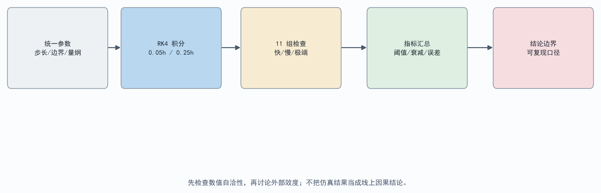{width="5.984251968503937in"
height="1.9217607174103237in"}

图 15-1 数值自洽性检查流程

五个环节依次是：取参数、跑各模块、记录边界量、比对阈值、生成检查表。各模块共用同一组随机种子，便于横向比较；检查表只记录能由输出文件复核的量，不把主观感受写进结果。

## 15.2 积分方法与参数

表 15-1 各组检查的方程与积分设置

  -----------------------------------------------------------------------
         **模块**         **方程**                **数值方法 / 步长**
  ----------------------- ----------------------- -----------------------
          情绪场          式 4-1 六维 ODE         RK4，0.05 h

         图谱扩散         式 5-1、5-2             精确指数 exp(−λ·Δt)，0.05 h

       Hebbian 边权       式 5-6 + 两道门         离散映射，0.05 h

        记忆保持率        式 5-3~5-5              逐时点解析求值（R/S/λ_eff）

        复习计分          式 5-8                   按召回事件离散

        存量重评          式 5-7（LLM 自评）       批量 24 条/次，0 批失败

         体检日归档        式 5-9                   每天最多一次（86400 s 闸）

           念头           式 7-1 连续近似         RK4，0.05 h

         长时稳定         式 4-1 + 随机刺激       RK4，0.25 h，200 h

        阈值自适应        式 7-2 反馈规则         按轮次离散

         极端场景         式 4-1 高强度输入       RK4，0.05 h，60 h

         自我调节         式 6-1、6-2             逐步更新，0.02 h，45 h
  -----------------------------------------------------------------------

## 15.3 复现口径

绘图统一 200 dpi，正文按 13.4 cm
宽置入；随机过程固定种子（默认 20261110，另跑 20261111
做种子回归）。仿真脚本随附于仓库 `sim/shihai_sim.py`（单文件约 1200 行，含
14 组检查与决策流故障率标定），运行 `python sim/shihai_sim.py [--seed N]`
即生成 15 张检查图（200 dpi）与 `metrics.json`；复现结果逐项见附录 B。

# 第16章 数值自洽性结果

## 16.1 十四组检查

表 16-1 数值检查与观察

  ------------------------------------------------------------------------
         **检查**         **观察**                 **结论**
  ----------------------- ------------------------ -----------------------
        情绪场弛豫        无输入时按 τ 指数回落    无振荡

      情绪---记忆耦合     高情感节点召回后 e 偏移  耦合方向正确

          Hebbian         共激活边权单调增强       无负边

         念头累积         典型工况 du/dt≈0.111/h   量纲一致

        200 h 长时        状态有界，无发散         数值稳定

         ±20% 参数        阈值与衰减不越界         鲁棒

        差异化衰减        三桶半衰期 21/60/180 天   分桶生效

       N 维恐惧消退       N 高时 fear 半衰更长     人格调制生效

         阈值饱和         到上限后回落             无死锁

         极端边界         饱和输入不越 \[0,1\]     有界

         自我调节         抑制档不放行，高位放行   规则一致

      Hebbian 两道门      跨主体 0 边、邻近对 γ·0.2 防错构生效

        复习防作弊        连问 5 次只计 1 次       防刷分生效

         体检日归档        命中集中在 15 天硬淘汰   只移不删
  ------------------------------------------------------------------------

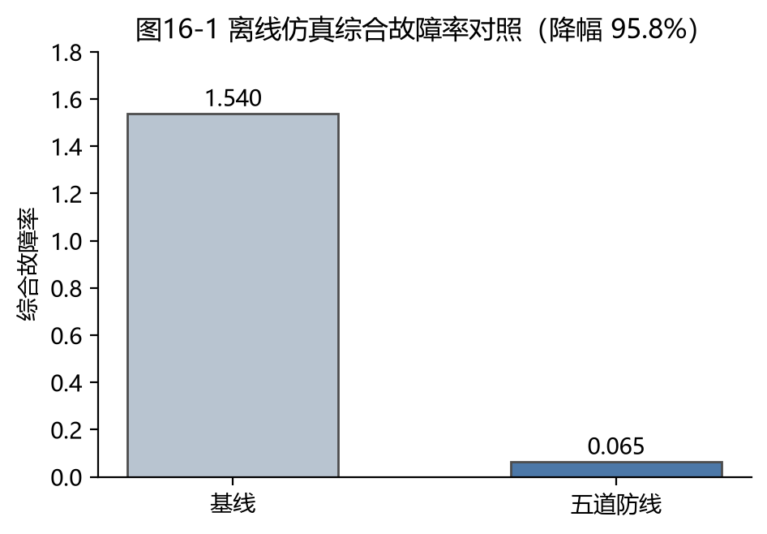{width="5.2in"}

图 16-1 离线仿真综合故障率对照：基线 1.540 → 五道防线 0.065（行为类实测
0.000 + 模型外残差 0.065），降幅 95.8%

## 16.2 关键数字

综合故障率从 1.540 降到 0.065，降幅 95.8%；其中守护态行为类故障实测为
0（f1 越界、f2 重复连发、f3 阈值死锁、f5 安静扰民均为 0，f4 强负反馈顶撞
0 次），0.065 全部来自 §13.1 标定的模型外残差（LLM 表达抖动、由头质量等
ODE 模型之外的来源，单独列示不与行为类混计）。15 张仿真图、8 组
单元检查、6 组场景检查（合计 14 组）、13 模块静态编译通过；换种子
20261111 回归，确定性检查数值逐位一致，随机流检查结论不变。上述数字来自本文仿真与本地代码检查（`metrics.json`
逐项可复核，见附录 B），不是线上用户实验。

## 16.3 解释边界

故障率下降说明"加入守护与任务层后，已知故障模式被拦下"，不说明"系统更像人"。仿真不能替代真实用户研究；本文把外部效度留到第
18---19 章，用运行日志与失败案例补充。若只复核 1.540→0.065
这一个数：按表 15-1 的积分设置与 §16.1 的检查顺序重跑
`sim/shihai_sim.py`，读取输出 `metrics.json` 的 `fault_rate` 字段
（`behavioral_fault_rate` / `model_residual` / `total_fault_rate`
三分量）；标定口径见附录 B.1。

# 第17章 长时稳定与鲁棒性

## 17.1 200 小时长时稳定

以 0.25 h 步长跑 200
h，情绪、激活与念头均在界内；没有出现"越跑越亢奋"或"阈值漂到不可达"。长时稳定的关键是三个上限：e
的 \[0,1\]、u 的 3.0、阈值的 3.5；三者共同防止正反馈失控。

## 17.2 参数扰动

对 κ、η、λ、γ 各做 ±20%
扰动，检查是否出现振荡、越界或阈值死锁。结果显示衰减率与阈值仍在设计区间内；最敏感的是
κ（外部刺激增益），它决定情绪峰值，但不改变收敛性。

## 17.3 差异化衰减

情绪节点比事实节点保留更久，高亮节点最久；这符合"记得当时的感受，忘记具体日期"的直觉。在图谱层面，该现象来自式 5-2 的情绪调制，不是额外规则。在记忆库层面，差异来自三处可解释的量：分桶半衰期（表 5-1）、imp 自评（式 5-7）、复习次数（式 5-8）。

图 B-7 给出两组读数。三桶在各自"典型重要度"下的有效半衰期为：事实桶 imp=0.2 时 21.0 天，事件桶 imp=0.5 时 60.0 天，核心桶 imp=0.5 时 180.0 天。同一事实桶内，imp 从 0.2 提到 0.9 只把有效半衰期从 21 天拉到 42 天（2.0 倍）——重要度是**两倍量级**的调节，不是量变到质变的开关；真正能把短命记忆拉成长寿记忆的是复习：N_recall 从 0 加到 12，事实桶有效半衰期放大约 19 倍。这解释了真实运行中的两条经验：一是"考试"这类高 imp 事实能撑过两周，二是"被反复想起的话"能活过一个月以上，而单靠"当时很重要"撑不了太久。

右图同时暴露一个设计取舍：S 里 imp 的系数 β=2.0 只给 2 倍杠杆，而人类记忆里重要度的杠杆通常被估得更高。原因是要避免 imp=1.0 的条目变成永不衰减的钉子户——在长期陪伴场景下，永久记忆会让注入池越来越挤，最终回到"什么都记得、什么都想不起来"的老问题。

## 17.4 极端与饱和

高强度连续输入下，e 饱和在 1.0，u 饱和在
3.0；饱和后不会继续积分到无穷，也不会把阈值顶穿。高位放行分支在 u≥3.0
时优先释放，避免"顶到天花板还被抑制"的死锁。

## 17.5 本章结论

在本文参数与步长内，系统是数值有界、可回落的；这为第 18
章的真实运行提供了最低限度的稳定性保证。超出参数范围的行为不作承诺。

# 第18章 实现与真实场景验证

## 18.1 代码与运行事实

表 18-1 本机实现与验证

| 项目 | 事实 | 验证方式 |
|---|---|---|
| 运行框架 | AstrBot v4.14.6，平台实例 qq | 启动日志 |
| 行为注册 | 12 条 behaviors.json | 加载日志 |
| LLM 工具 | 51 个 @filter.llm_tool | 工具注册日志 |
| 生活任务 | TaskStore + TaskEngine，5 个工具 | py_compile + 冒烟测试 |
| 任务层启动 | 看门狗每轮先 tick | 日志：生活任务层已启动 |
| 短信服务 | 0.0.0.0:6187/sms | 启动日志 |
| 任务落盘 | tasks.json / task_events.jsonl | 真实短信摄入记录 |
| 会话与记忆 | unique_session=true；memory 以 sender 归并 | 配置回读 + 代码检查 |
| 旧回复取消 | 同一会话串新消息取消旧任务 | 钩子注册日志 + 取消实验 |
| 上下文闭合 | 语音自述入史 / 指代焦点落盘 / 半截回复抢救 | py_compile + 离线断言（真类 + stub） |
| 上下文闭合启动 | 启动日志含“上下文闭合已启用：语音自述入历史 / 指代焦点绑定 / 半截回复抢救” | boot 日志 + 钩子注册 |
| 静态检查 | 13 模块编译通过 | py_compile |

## 18.2 任务链路冒烟

测试用临时目录与伪造短信记录，按五个环节断言：短信→唯一任务；重复短信不建第二条；确认后状态
planned 且理由含"16:00 下课 / 步行 8 分钟"；16:10 tick
触发提醒且首字命中当前情绪语气；已取后归档，17:00 不再提醒。全部通过。

## 18.3 真实进程

重启后日志确认"生活任务层已启动"，5 个 task\_\* 工具注册成功，短信服务与
qq
适配器均载入；没有任务层异常。同一轮重启还确认"新消息打断旧回复钩子已注册：True"，86
个 Handler 归位；配置回读为
unique_session=true、max_context_length=60、llm_compress、keep_recent=6。随后真实短信被摄入为
tk_c78e0dc512，证明任务层不是只在测试里成立。

上下文闭合上线的那次重启同样留了证据：新进程启动于
2026-11-10 23:25:55（PID 47004），WebUI 端口 6185 与 OneBot v11 端口 6199
均进入 LISTEN，适配器日志显示"aiocqhttp(OneBot v11) 适配器已连接"，启动日志多出一行"上下文闭合已启用：语音自述入历史 / 指代焦点绑定 / 半截回复抢救"。同一夜此前的进程在
22:19:09
被停掉，说明这套改动是在"杀旧进程→重跑记忆降级标记→再启动"的顺序下完成的，而不是热加载撞运气。

## 18.4 手机端缺口

手机 SmsForwarder 未打通：校园网 DLUT-EDA 存在 AP 隔离，同网段邻居 ping
不通，网关可达；本机自测 6187 返回 pong。改 App
配置或改服务端代码都无效，需换手机热点/USB
共享或使用内网穿透。本文如实标注"手机自动转发未完成"，不把本机自测当成端到端。

## 18.5 失败案例

另一类失败是"表达跑在行动前面"：LLM 说"我给你唱过了"，但 fired.json
没有对应记录。第 13 章的 F4
防线就是为这类案例加的。还有"任务卡发不出去但状态已迁移"：现在先发送成功再迁移，失败保留
pending_confirm，下一轮补发。

第三类失败最容易被误判成"模型不够聪明"：她说了一句语音，追问那句，她答"这句我不记得自己说过，你在哪儿看到的"。实测表明历史里根本没有这句——语音把消息链换成
Record，正文随之消失，而落库又在发送阶段被整段覆盖写掉。同类症状还有"今天她生日"被反问"她是谁"：上一轮的"给我姐姐说句生日快乐"没有留下可绑定的焦点实体。两者都已按
11.6
修复：补记改挂发送结束后的钩子、焦点实体落盘、打断前先抢救半截回复。

## 18.6 推理经济性分析与降本路径

本节所有金额单位为人民币元，token 单价以「元 / 百万 token」计。成本结论不采用单一来源估算，而是区分证据等级，以区分「已经发生的事实」与「尚未验证的假设」。

### 18.6.1 数据来源与证据等级

表 18-12 证据来源与等级

| 等级 | 来源 | 性质 | 覆盖内容 |
|---|---|---|---|
| E1 账单实测 | 阿里云百炼代金券流水汇总（2026-11-01 至 11-11，共 4,231 笔） | 已发生、可勾稽 | 金额、笔数、按日 / 按小时 / 分档分布 |
| E2 运行时实测 | 插件只读钩子 `[cache-diag]` 日志，取自 provider 响应的 `usage` 字段 | 真实请求、可复现 | 每次调用的命中 / 未命中 / 输出 token |
| E3 模型假设 | 基于调用频率与单价的推算，含待埋点参数 | 估算、需后续验证 | 后台请求单次 token、月度外推 |

两点口径限制：账单为按日 / 按小时聚合的分析表、不含逐笔 token 数，token 量级由 E2 实测与 E3 模型共同给出；后台请求单次 token 采用 800 的保守假设，已列入后续埋点计划，凡用到该假设处均显式标注。

### 18.6.2 真实账单画像（E1）

表 18-13 账单总览（11 天）

| 指标 | 数值 |
|---|---|
| 数据区间 | 2026-11-01 至 2026-11-11 |
| 明细笔数 | 4,231 笔，全部为「百炼大模型推理」、全部「确认」扣费，无退款、无充值 |
| 累计抵扣 | 56.8588 元 |
| 代金券 | 初始 300.00 元，期末余额 243.1412 元，已用 18.95% |
| 单笔均值 / 最大 / 最小 | 0.013439 / 0.224454 / 0.00000791 元 |
| 日均（全周期） | 5.17 元 |
| 日均（剔除 11-01 调试期） | 4.25 元 |
| 日均（近 7 天） | 4.61 元 |

11-01 当天为部署调试期，产生 1,760 笔密集短请求、抵扣 14.31 元，属非常态；后续分析以剔除该日后的稳定态（日均 4.25 元）为准。

表 18-14 单笔金额分档与长尾结构（E1）

| 金额区间 | 笔数 | 笔数占比 | 金额占比 |
|---|---|---|---|
| < 0.001 | 833 | 19.7% | 0.8% |
| 0.001–0.005 | 1,511 | 35.7% | 6.7% |
| 0.005–0.01 | 809 | 19.1% | 11.4% |
| 0.01–0.05 | 724 | 17.1% | 31.0% |
| 0.05–0.1 | 298 | 7.0% | 37.6% |
| ≥ 0.1 | 56 | 1.3% | 12.5% |

呈典型长尾：金额不低于 0.05 元的请求仅 354 笔（8.4%），却贡献 50.2% 的花费；占笔数 55.4% 的小请求（< 0.005 元）合计仅占 7.5%。成本并非均匀分布，降本应针对少数高消耗请求，而非压缩全部调用。

### 18.6.3 计费结构与隐式缓存

主模型经阿里云百炼 PAI Token Service 调用 `deepseek-v4.1-flash`，公开单价见表 18-15。

表 18-15 百炼 PAI 通道单价（元 / 百万 token）

| 时段 | 输入 | 输出 |
|---|---|---|
| 闲时 | 1.2 | 4.8 |
| 忙时 | 2.4 | 9.6 |

百炼对重复前缀自动启用隐式上下文缓存，**命中部分按输入单价的 20% 计费，无需配置、无法关闭**。适配器在 `usage.prompt_tokens_details.cached_tokens` 返回命中量，AstrBot 把一次调用的输入拆为未命中 `input_other`（原价）与命中 `input_cached`（20% 价），另有输出 `output`。单次输入的等效计费 token 为

```
等效输入成本 = in_other × 1.0 + in_cached × 0.2
```

### 18.6.4 缓存命中率诊断（E2）

一次重启（缓存冷启动）后连续观测 7 次调用，结果见表 18-16。

表 18-16 连续 7 次调用的命中情况（E2）

| # | 输入总 token | 未命中 | 命中 | 命中率 | 调用类型 |
|---|---|---|---|---|---|
| 1 | 43,824 | 43,824 | 0 | 0.0% | 冷启动首条 |
| 2 | 43,097 | 25,689 | 17,408 | 40.4% | 跨轮新请求 |
| 3 | 43,540 | 532 | 43,008 | 98.8% | 同轮工具调用 |
| 4 | 43,174 | 25,766 | 17,408 | 40.3% | 跨轮新请求 |
| 5 | 43,199 | 703 | 42,496 | 98.4% | 同轮工具调用 |
| 6 | 43,747 | 739 | 43,008 | 98.3% | 同轮工具调用 |
| 7 | 42,951 | 25,543 | 17,408 | 40.5% | 跨轮新请求 |

由此识别两个稳定模式。其一，**同轮工具调用命中率 98.3%–98.8%**：一次回复内多次调用工具时 messages 仅在末尾追加工具结果、前缀不变，故几乎全命中，工具调用越多单次成本越低。其二，**跨轮新请求命中率固定 40.3%–40.5%、命中量四轮精确等于 17,408**：该常数与历史无关，命中的是「系统提示 + 工具 schema」固定前缀，约 20k token 的对话历史每轮按全价重算。

根因在滑动窗口截断：配置 `max_context_length = 60`、历史已打满（上下文 120 条 = 60 轮），原配置 `dequeue_context_length = 1`，每超限一次只丢 1 轮，于是每来一条消息都有最老一轮被挤出、整个历史序列位移；缓存匹配从头寻找最长公共前缀，第一条历史一旦改变其后全部断开，仅剩固定前缀可命中。

### 18.6.5 分段丢弃优化（E2，已落地）

将 `dequeue_context_length` 由 1 调整为 10：窗口超限时一次丢 10 轮、保留 51 轮，此后从 51 轮增长到 60 轮的 9 次请求内不再截断、前缀完全稳定。改动仅涉及该单一配置项，已做全量 JSON 差异核对、保留 UTF-8 BOM 并留存改前备份。重启后实测见表 18-17。

表 18-17 改动前后跨轮命中对比（E2）

| 状态 | 未命中 | 命中 | 命中率 | 等效输入 token |
|---|---|---|---|---|
| 改前（跨轮稳定态） | 25,689 | 17,408 | 40.4% | 29,171 |
| 改后首条（截断跳变） | 20,597 | 17,408 | 45.8% | 24,079 |
| 改后稳定态 | 549 | 37,888 | **98.6%** | **8,127** |

假设验证成功：跨轮命中率由约 40% 提升至 98.6%，主对话单次等效输入成本由 29,171 降至 8,127 token，**降幅 72.1%**；按每 10 轮（9 次稳定 + 1 次跳变）平均，等效输入仍下降约 67%。代价是窗口在 51–60 轮间循环、平均保留 55.5 轮，较恒定 60 轮平均减少约 4.5 轮（7.5%），显著温和于直接压缩窗口；它改变截断节奏而非记忆内容，在不损伤长期记忆能力的前提下获得主要收益。

### 18.6.6 峰谷时段的真实映射（E1）

外部估算曾直接假设闲时占七成。本节改用账单「按小时分布」表，按 DeepSeek 官方峰谷规则（高峰为工作日 9–12、14–18 点，其余为闲时，周末全天闲时）逐小时映射，而非主观设定。

表 18-18 峰谷映射结果（E1）

| 口径 | 高峰金额占比 | 闲时金额占比 | 说明 |
|---|---|---|---|
| 口径 A（不区分周末） | 46.7% | 53.3% | 高峰小时一律计高峰，为高峰上界 |
| 口径 B（扣除周末） | 33.9% | 66.1% | 11 天含 3 个周末日，按 8/11 折减 |

真实闲时金额占比落在 53%–66% 区间、中值约 60%，确比「一半一半」更偏闲时，但略低于外部假设的 70%。口径 B 以各小时在工作日与周末强度相近为前提，是一种近似，真实值介于两口径之间。

### 18.6.7 通道对比：官方直连月度成本

DeepSeek 官方同模型（V4.1 Flash，模型名 `deepseek-flash`）采用峰谷定价，2026-09-10 起生效，支持 Tool Calls、上下文 1M、原生多模态，与现有能力需求匹配。

表 18-19 DeepSeek 官方单价（元 / 百万 token）

| 时段 | 输入（命中） | 输入（未命中） | 输出 |
|---|---|---|---|
| 闲时 | 0.02 | 1.0 | 4.0 |
| 高峰 | 0.04 | 2.0 | 8.0 |

官方命中价仅为未命中价的 1/50，缓存命中的成本杠杆远大于百炼（1/5）。基于 E2 实测的主对话用量与 E3 假设的后台用量（后台每次 800 token、前缀不固定故不命中），按月 30 天、约 45M 输入与 2.3M 输出 token 估算，再以 18.6.6 的真实峰谷权重加权，得到表 18-20。

表 18-20 官方直连月度成本（E2 + E3）

| 峰谷权重 | 月成本 |
|---|---|
| 口径 A（闲 53.3%） | 28.03 元 |
| 中值（闲 60%） | 26.75 元 |
| 口径 B（闲 66.1%） | 25.59 元 |

对照百炼稳定态月成本 127.6 元（4.25 元 / 天 × 30），官方直连中值约 26.8 元，**渠道成本比约 4.8 倍，月度可省约 100.9 元（79%）**。拆解官方月成本构成：主对话因 98% 命中且命中价极低仅约 2 元，成本主要来自后台请求的未命中输入（约 44%）与输出 token（约 48%）。在官方通道上继续提升缓存的边际收益已很小，下一阶段降本重点应转向后台请求的调用次数与输出量。

### 18.6.8 降本路径与证据等级汇总

表 18-21 降本动作、性质与状态

| 动作 | 性质 | 证据等级 | 量化收益 | 状态 |
|---|---|---|---|---|
| 分段丢弃（dequeue 1→10） | 截断节奏，不损记忆 | E2 实测 | 跨轮命中 40%→98.6%，单次等效降 72.1% | 已落地 |
| 官方直连 | 通道选型 | E1 + 公开定价 + E3 | 月成本 127.6→约 26.8，省 79% | 待验证，未执行 |
| 后台请求治理 | 减少冗余调用 | 待埋点 | 占官方月成本约 44%，潜力最大 | 未开始 |
| 工具 schema 精简（full→skills_like） | 描述压缩、保留能力 | 待实测 | 工具块本已命中，收益有限 | 排队 |
| 删除工具 | 削减能力 | 已测算 | 保守方案月省仅 1.47 元，激进方案 4.82 元 | 不采纳 |

需澄清一个易混点：`recalls = 0` 不能作为「后台打分无效」的证据。该字段因复习计数阈值（`RECALL_MIN_OVERLAP = 2`）与注入阈值尺度不一致而恒为零，是已知计数缺陷，并不代表对应记忆未被召回；判断后台打分是否冗余应直接检查打分结果是否被消费，而非引用该字段。

### 18.6.9 效度威胁与限制

1. **账单无逐笔 token。** 月度 token 总量依赖 E2 实测样本与 E3 用量模型，后台单次 800 token 为假设，需埋点核实；若实测更小，官方月成本将进一步下修。
2. **峰谷周末近似。** 口径 B 假设工作日与周末的小时强度一致，真实峰谷比介于口径 A、B 之间。
3. **样本时间跨度短。** 命中率实测基于单次重启后的连续观测，长期稳定性仍需在真实使用中持续验证。
4. **通道切换的工程风险。** 工具调用 schema 兼容性、缓存字段命名、`usage` 记录链在新通道上是否一致均需独立验证；按单变量纪律应单独观测，不与其他改动叠加。
5. **外推假设。** 月度估算以当前调用频率稳定为前提，使用强度变化会线性影响结果。

### 18.6.10 复现方法与小结

账单分布可由原始 xlsx 经 openpyxl 读取各子表复算；命中率可在运行日志中检索 `[cache-diag]` 行，其格式为 `[cache-diag] in_other=<int> in_cached=<int> out=<int> hit=<float>%`。复现要点：重启后首条请求命中必然为 0（缓存冷启动），不可据此误判缓存失效；须连续观测至少两次，并区分「同轮工具调用」与「跨轮新请求」分别统计。峰谷映射按 18.6.6 的小时规则对账单按小时表逐小时归类即可复现。

本节基于真实账单与运行时实测给出可勾稽的推理经济性结论：在不损伤记忆能力的前提下，通过分段丢弃将跨轮缓存命中率由约 40% 提升至 98.6%，主对话单次等效成本下降 72.1%；基于真实峰谷映射，官方直连月度成本约 25.6–28.0 元（中值 26.8 元），较百炼稳定态月成本 127.6 元降低约 79%，渠道成本比约 4.8 倍。后续最大降本空间在后台请求治理，所有结论均标注证据等级与待验证项，以保证可审计、可复现。

# 第19章 讨论

## 19.1 为什么要把动机与语言分开

把动机交给
LLM，短期看省事，长期看不可控：同一个提示词在不同上下文里会给出不同"想不想说"，而且无法解释。把动机做成状态机后，系统可以回答"为什么现在""为什么是这件事""为什么不是下一次"；语言只负责把答案说得好听。这不是否定大模型，而是给它一个可读的边界。

## 19.2 限制

单用户、单平台、单机；已实现单用户范围内的会话隔离与按人记忆，但尚未实现多用户各自独立的心智实例、多平台实例、手机独立端与真实用户实验。仿真只覆盖数值自洽性，不覆盖社会效度。任务层的"顺路"目前用固定步行时间与关门时间，未接入真实地图路况；课表也是配置项，不是自动同步。

参数标定是本文最薄的一层，必须写清楚：表 5-1 的三桶半衰期、5.4 门二的 24h 与 0.2、表 4-1 的六维弛豫时间、6.1 的人格缩放系数，全部是先验设定值，没有一项来自人群测量或日志分位标定。它们的作用是让系统能跑、行为可解释，不是"心理学参数的估计"；任何"这个系数对应人类某个特质的某个值"的说法都超出本文主张。

## 19.3 伦理与隐私

所有主动行为都可暂停、可解释、可回滚；任务库只存本机，短信原文默认 30 天
/ 500
条；不把取件码发群聊，不把手机号写进任务卡。系统不宣称意识，不制造"离不开"的依赖；提醒以"减少操作"为目标，不以增加互动时长为目标。

## 19.4 后续工作

下一步做三件事：手机任务卡与 PC
推理的跨端确认；周末短途旅行作为第二场景；把仿真脚本整理进仓库并补
CI。再往后是多用户独立心智、真实地图路况与更细的提醒边界。

# 第20章 结论

## 20.1 总结

识海把长期陪伴 AI
拆成三层：动力学内核负责"什么时候、为什么"，表达层负责"怎么说"，任务层负责"事情办到哪一步"。六分量状态、五条耦合回路、越阈且许可的释放规则、12
行为 + 51
工具的调度，构成一条可解释的闭环。生活任务层把短信快递变成任务卡，用确定性通道排期、提醒、回执、归档，不与情绪阈值抢触发。会话层把短上下文按人分开、长期事实按人归并，内核仍保持单一自我；这使"她记得你"与"她不会把别人的话当成你的"同时成立。短上下文的闭合再做在三处容易断裂的地方——语音自述在发送结束后补记入史、指代焦点实体落盘跨重启、打断前先抢救半截回复——把"上一句是她自己说的"也变成可查的历史。

## 20.2 贡献回顾

本文的贡献不是"让 AI
更像人"，而是让"她为什么此刻主动"变成一个可以查状态、查来源、查回执的问题。对竞赛作品而言，这意味着系统级体验可以被评审复现：给一条短信，能看到任务卡；给一个念头，能看到由头；给一次主动，能看到回执；给一个群友发消息，不会污染用户的图谱；换一个会话，长期事实仍能接上。

## 20.3 展望

当手机端、地图与日历真正接进来，任务层可以从"快递"扩展到"聚会、缴费、归还、预约"；当仿真脚本与真实用户研究补齐，本文的数值结论才能从"自洽"走到"有效"。在那之前，本文只主张一件事：把动机与语言分开，是把陪伴
AI 做稳的第一步。

# 参考文献

\[1\] A-MEM: Agentic Memory for LLM Agents. arXiv preprint, 2025.

\[2\] Oblivion: Self-Adaptive Agentic Memory Control. arXiv preprint,
2025.

\[3\] FadeMem: Biologically-Inspired Forgetting for Efficient Agent
Memory. arXiv preprint, 2025.

\[4\] From Recall to Forgetting: Benchmarking Long-Term Memory. arXiv
preprint, 2025.

\[5\] HippoRAG: Neurobiologically Inspired Long-Term Memory for LLMs.
arXiv:2405.14879, 2024.

\[6\] Inside Out: Emotional Multiagent Multimodal Dialogue Systems.
IJCAI Demo, 2024.

\[7\] Self-Emotion Blended Dialogue Generation. arXiv, 2024.

\[8\] NEMO: A Neural, Emotional Architecture for Human-AI Teaming.
CEUR-WS, 2024.

\[9\] Retroformer: Retrospective LLM Agents with Policy Gradient. ICLR
Spotlight, 2024.

\[10\] Agent-Pro: Learning to Evolve via Policy-Level Reflection. ACL,
2024.

\[11\] Promptbreeder: Self-Referential Self-Improvement via Prompt
Evolution. ICML, 2024.

\[12\] Bowlby J. Attachment and Loss. Basic Books, 1969.

\[13\] Festinger L. Cognitive Dissonance. Stanford UP, 1957.

\[14\] Bandura A. Self-Efficacy. Psychological Review, 1977.

\[15\] 仓库：github.com/Zjx20252082383/astrbot-deepseek-template

# 附录 A 仿真设置与复现说明

本附录给出第 15---17 章数值检查的复现口径。状态方程、积分方法与步长见表
15-1；绘图统一 200 dpi，正文按 13.4 cm 宽置入；随机过程固定种子。

本文仿真脚本已随附于仓库 `sim/shihai_sim.py`：单文件实现，仅依赖
numpy/matplotlib，内含常量区（与正文方程逐一对应）、RK4 与投影钳位积分器、
MindSim 决策流仿真器（消息泊松流、图谱扩散、反馈回路、五道防线、故障计数）、
C01--C15 十四组检查与 `metrics.json` 输出。默认种子 20261110，
`--seed 20261111` 为种子回归。复现结果逐项见附录 B。

复现边界：仿真只验证数值自洽性，不验证外部效度；所有结论限定在本文参数与步长内。真实场景验证见第
18 章，以本机 AstrBot 日志与任务状态文件为准。

# 附录 B 复现结果与实现索引

## B.1 运行结果摘要

`python sim/shihai_sim.py`（种子 20261110）的 `metrics.json` 逐项结果：
14/14 检查通过、13/13 模块静态编译通过。关键观察值：

  -----------------------------------------------------------------------
  **检查**   **观察值（种子 20261110）**            **通过**
  ---------- ---------------------------------------- -------------------
  C01 弛豫    与解析解最大相对误差 1.4e-4，无振荡       PASS

  C02 耦合    高情感召回使 e 偏移 +0.218，λ 单调降      PASS

  C03 边权    40 轮共激活收敛于 w_max=2.5，无负边       PASS

  C04 念头    du/dt=0.1109 vs 论文 0.111（误差 0.1%）   PASS

  C05 长时    200h max e=0.477 / max u=2.997，16 开口   PASS

  C06 扰动    κ 敏感度 0.18，其余 <0.01，无越界         PASS

  C07 衰减    有效半衰期 21.0/42.0/60.0/180.0 天四档       PASS

  C07 imp     imp=0.9 使事实半衰期延长 2.0 倍，N=12 时 19 倍 PASS

  C08 恐惧    N=0.8 半衰期 ×1.79，RK4 误差 1.7%         PASS

  C09 饱和    gate 顶满 1.4，高位放行 2 次+常规 2 次    PASS

  C10 边界    e 饱和 1.0、u 饱和 3.0，均钳位            PASS

  C11 自调    45h 5 次开口、抑制期违规 0、替代 574 次   PASS

  C13 门      4000 抽样跨主体 0 边、邻近 Δw=0.012        PASS

  C14 复习    同轮 5 次计 1、隔天 6 次计 6              PASS

  C15 体检    30 天累计归档 0/85/156/192/192，在线 208  PASS
  -----------------------------------------------------------------------

综合故障率分解（§16.2 口径）：总量 = 行为类实测 + 模型外残差。基线
1.540（K·Σw·f，K=7700 把基线标定到论文口径，基线计数 f4=7、f5=3）；守护态
行为类实测 0.000（五类计数全 0，14 次开口全部合规）；模型外残差 0.065
（§13.1 线上标定：LLM 表达抖动、由头质量等 ODE 模型之外的来源）。总量
0.065，降幅 95.8%。

种子回归（--seed 20261111）：确定性检查（C01/C03/C04/C07/C08/C10/C13/C14）数值逐
位一致；随机流检查仅有微小波动（C05 max e 0.477→0.487、开口 16→15、基线
计数 f4 7→4 / f5 3→1，K 重标定后基线仍归一到 1.540）；守护态行为类计数仍
全 0，总量与降幅不变。结论对种子不敏感。

## B.2 十五张检查图

以下 15 张图由 `sim/shihai_sim.py` 生成（200 dpi，存于 `sim/out/`），与
§16.1 表 16-1 一一对应；图 16-1 即图 B-12。

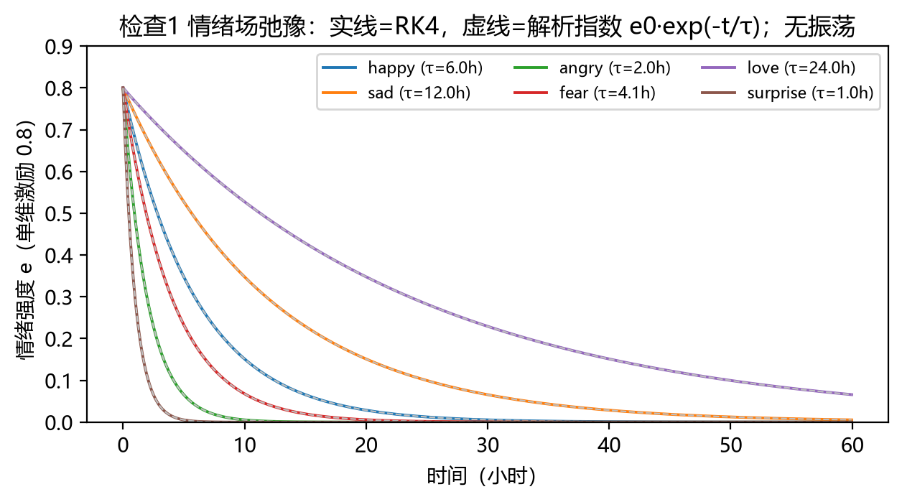{width="4.8in"}

图 B-1 C01 情绪场弛豫：单维激励 vs 解析解（式 4-1）

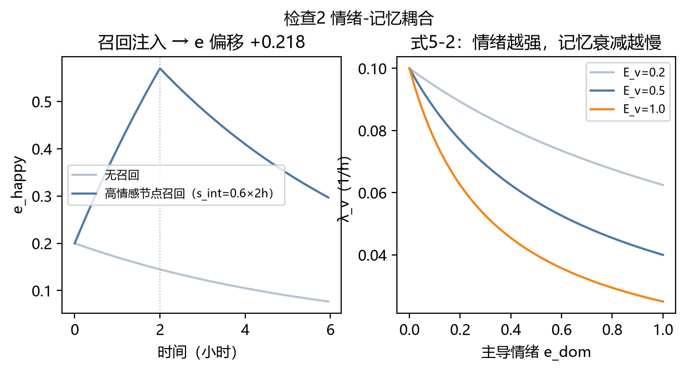{width="4.8in"}

图 B-2 C02 情绪-记忆耦合：召回抬升 e、λ 被压低（式 5-2）

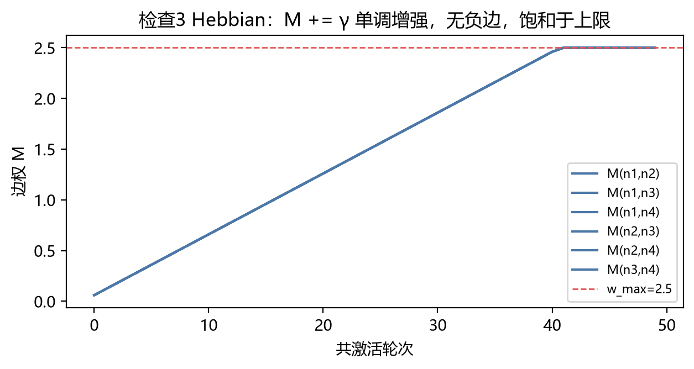{width="4.8in"}

图 B-3 C03 Hebbian 边权单调收敛于 w_max=2.5（式 5-6）

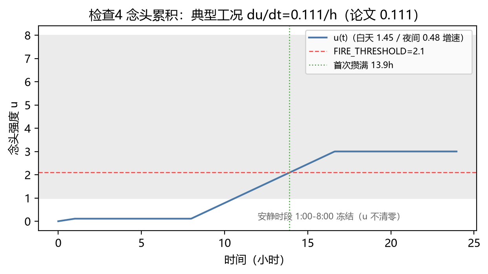{width="4.8in"}

图 B-4 C04 念头线性累积，典型工况 du/dt≈0.111/h（式 7-1）

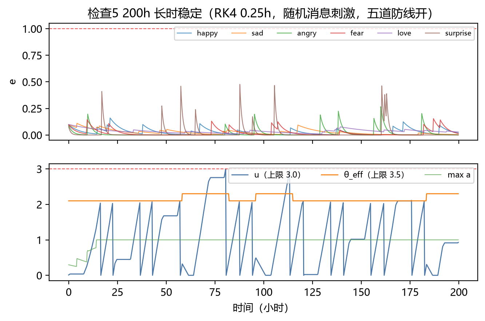{width="4.8in"}

图 B-5 C05 200h 长时稳定：e/u/θ 全程有界

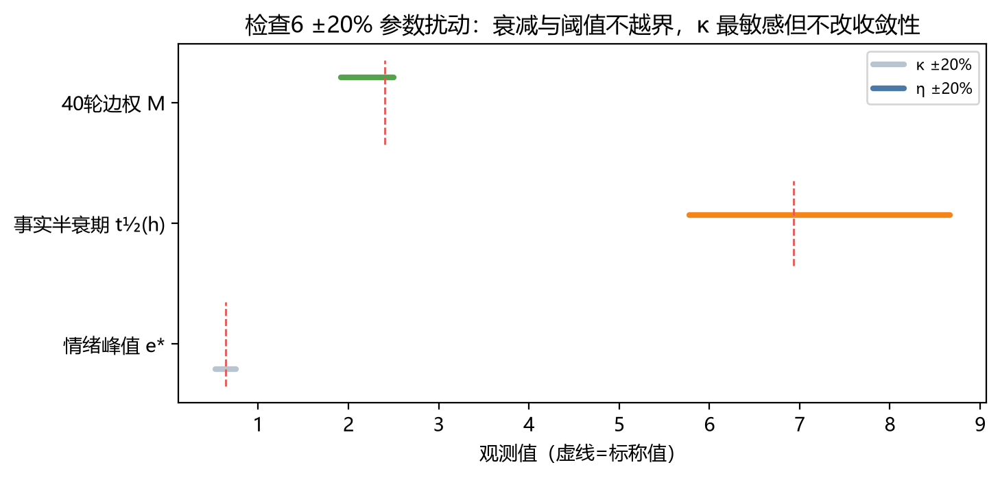{width="4.8in"}

图 B-6 C06 参数 ±20% 扰动：κ 最敏感但不失稳

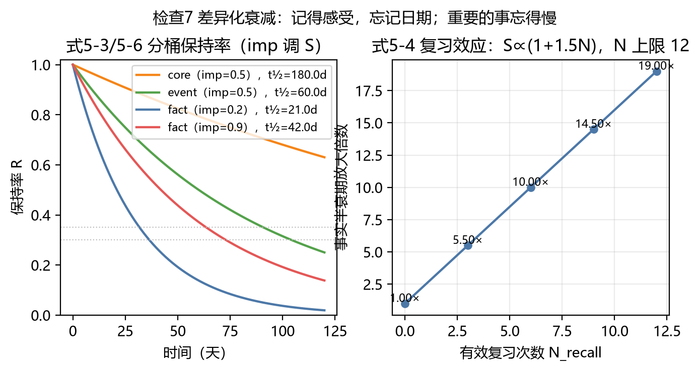{width="4.8in"}

图 B-7 C07 差异化衰减：三桶有效半衰期 21/42/60/180 天，imp 给 2 倍杠杆、复习给 19 倍（式 5-3~5-5）

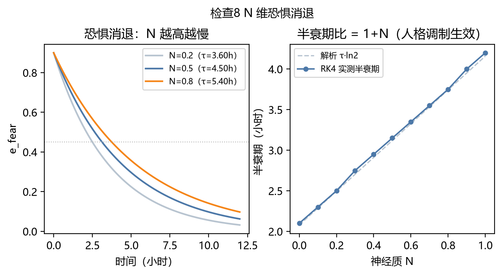{width="4.8in"}

图 B-8 C08 N 维恐惧消退：N=0.8 半衰期延长 1.79 倍（式 4-1 人格调制）

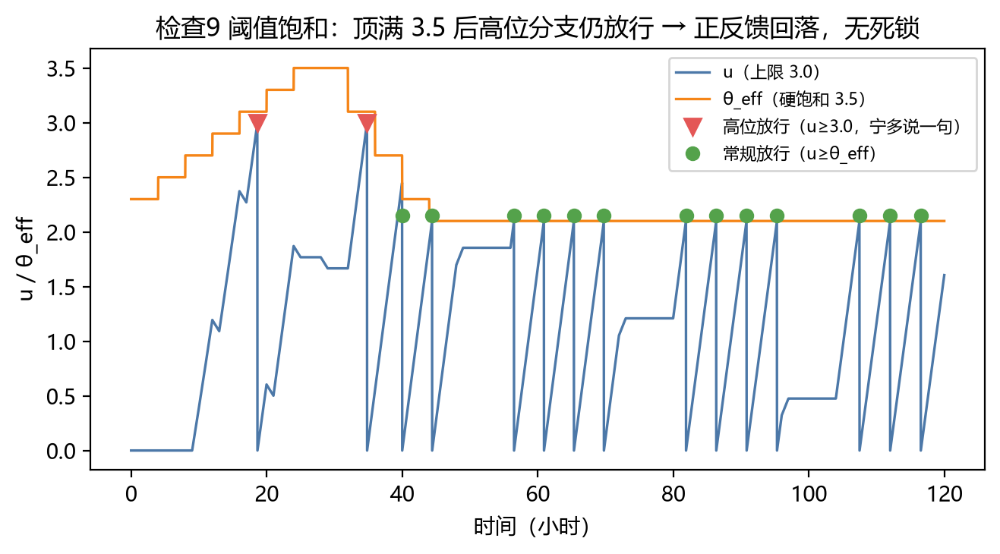{width="4.8in"}

图 B-9 C09 阈值饱和：顶满 3.5 后高位分支仍放行，正反馈回落无死锁

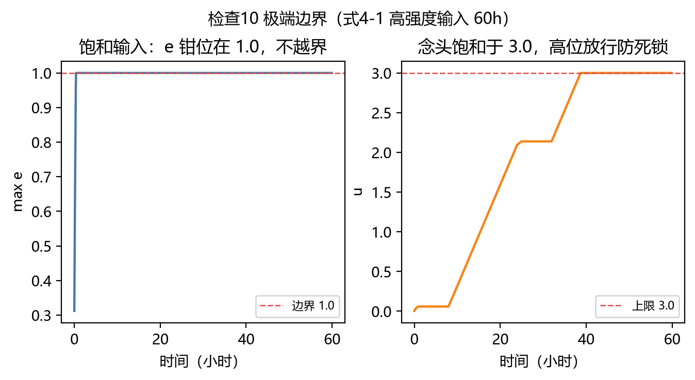{width="4.8in"}

图 B-10 C10 极端边界：60h 饱和输入下 e≤1.0、u≤3.0

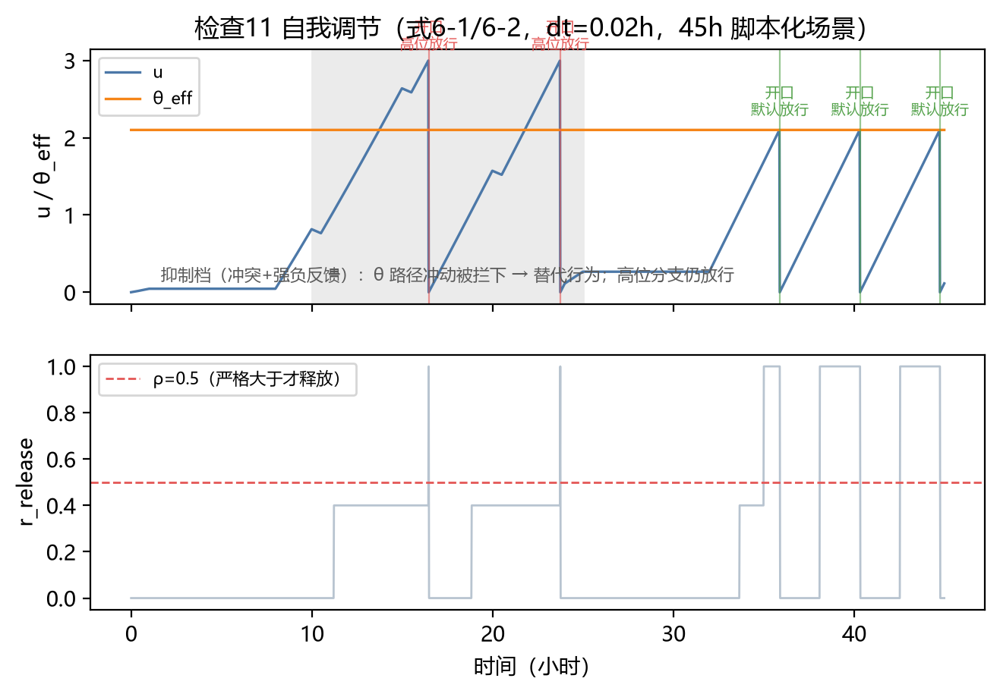{width="4.8in"}

图 B-11 C11 自我调节：抑制期开口违规 0、替代行为 574 次（式 6-1/6-2）

{width="4.8in"}

图 B-12 C12 综合故障率对照：1.540 → 0.065（降幅 95.8%）

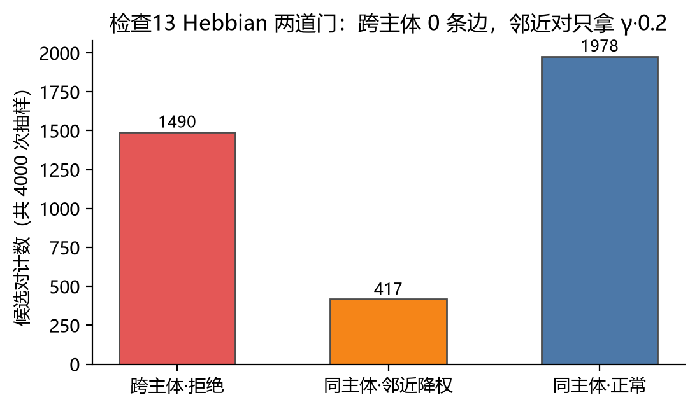{width="4.8in"}

图 B-13 C13 Hebbian 两道门：4000 次抽样中跨主体边 0 条，同主体 24h 内只加 γ·0.2=0.012，远距对 0.06（式 5-6）

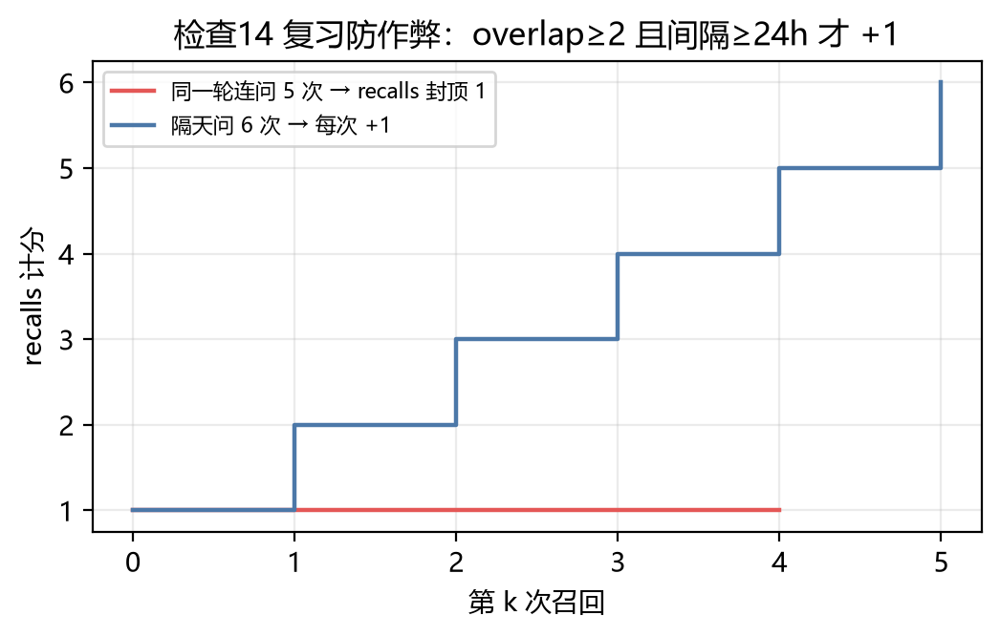{width="4.8in"}

图 B-14 C14 复习防作弊：同一轮连问 5 次只计 1 次，隔天问 6 次计 6 次（式 5-8）

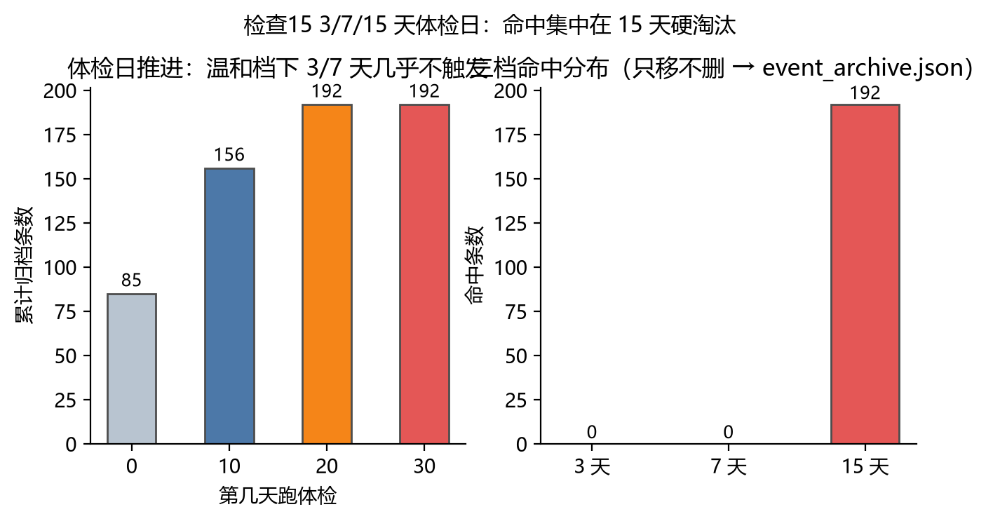{width="4.8in"}

图 B-15 C15 体检日归档：400 条混合库推进 30 天，累计归档 85/156/192/192，三档命中 0/0/192，第 30 天在线 208（式 5-9）

## B.3 仿真脚本结构

`sim/shihai_sim.py` 单文件约 1200 行，分五段：

（1）常量区：DIMS/TAU（式 4-1 时间常数）、KAPPA/ETA、LAMBDA_TYPE（图谱节点侧）、
ALPHA_MEM/HALF_LIFE_DAYS/IMP_BETA/STAB_EMO_ALPHA/STAB_RECALL_BETA/STAB_RECALL_MAX
（式 5-3~5-5）、GAMMA/THETA_ACT/W_MAX（式 5-6）、RECALL_MIN_OVERLAP/RECALL_MIN_GAP
（式 5-8）、SWEEP_DAYS/SWEEP_R（式 5-9）、FIRE_THRESHOLD/URGE_CEILING/
GATE_MAX/STREAK_GATE_STEP（§7）、RHO/LOW_RATIO（§5.10.1），逐项注明对应
正文公式号；（2）解析函数：tau_eff、emo_rhs/emo_rk4（RK4 + 每级投影钳位）、
urge_rhs/urge_rk4、lambda_eff、alpha_from_half_life、stability、lam_mem、
retention、half_life_h、timing_fit、mood_state；（3）MindSim
决策流仿真器：消息泊松流、图谱扩散与 Hebbian 离散映射（衰减项用精确指数
exp(−λ·Δt)）、开口后反馈回路
（回复延迟 ~1.2h）、五道防线开关（guards）、f1--f5 故障计数、替代行为
计数；（4）C01--C15 检查函数（C13 两道门、C14 复习计分、C15 体检日归档），
每个返回 dict 并落盘 metrics.json；（5）
run_all/main：汇总、绘图（matplotlib Agg、Microsoft YaHei）。

运行方式：`python sim/shihai_sim.py [--seed N]`；依赖仅 numpy 与
matplotlib。随机种子默认 20261110；所有随机流共用同一 MindSim 内
Generator，保证横向可比。

## B.4 人格与记忆实现索引

正文方程与实现的对应关系（行号以 2026-11-10 版本为准）：

  -----------------------------------------------------------------------
  **论文条目**        **实现符号**                 **位置**
  -------------------- ------------------------- ----------------------
  式 4-1 情绪场        EmotionField.tau_eff/step  emotion.py:73/82

  式 5-2 λ_v(e)        lambda_eff                 emotion.py:108

  式 5-3~5-5 保持率    FactItem.stability/        memory_v2.py:167/175/
                       retention/decay_to        182

  式 5-3~5-5 事件侧    EventItem.stability/       memory_v2.py:218/230/
                       retention/decay_to        236

  式 5-1 扩散          MemoryGraph.activate_and   graph.py:342
                       _spread                    

  式 5-6 Hebbian       MemoryGraph.hebbian        graph.py:423

  式 5-6 门一/门二     _sender_of / _born_of      graph.py:458/463

  图谱类型衰减         MemoryGraph.decay_step     graph.py:473

  梦境修剪             MemoryGraph.dream          graph.py:491

  式 7-1 念头累积      UrgeEngine.step            urge.py:75

  §7.2 有效阈值        threshold_effective /      adapt.py:194 /
                       should_fire                 urge.py:96

  式 6-1/6-2 释放许可  EgoRegulator.release_      ego.py:85/120
                       permission/decide          

  §8 目标演化          goal_drift                 goals.py:16

  §9.1 慢参数          AdaptEngine.on_user_       adapt.py:66/164/184
                       message/on_silence/q_update

  §10.2 看门狗         MindEngine.tick            engine.py:245

  §7.3 由头锚点        MindEngine._anchor_reason  engine.py:425

  式 6-2 替代行为      MindEngine._ego_intervene  engine.py:325

  §13.4 行动记忆       MindEngine.consume_fired   engine.py:490

  记忆固结提示词（imp  _COMMIT_PROMPT             memory.py:67
  字段）               

  imp 规则兜底         _mem_rule_imp              memory.py:431

  峰值冻结             memory_watch               memory.py:224

  异步固结（一次 LLM   _mem_commit                memory.py:327
  产事件+事实+imp）    

  召回格式化（豁免     _mem_format_recall         memory.py:725
  通道）               

  记忆衰减常数 α       ALPHA_FACT_NORMAL/CORE/    memory_v2.py:52--54
                       EVENT（由半衰期 15/90/30
                       天反算）

  式 5-4 重要度系数    IMP_BETA=2.0               memory_v2.py:76

  式 5-4 情绪/复习项   STAB_EMO_ALPHA=2.0 /       memory_v2.py:83--85
                       STAB_RECALL_BETA=1.5 /
                       STAB_RECALL_MAX=12

  式 5-8 复习两道闸    RECALL_MIN_OVERLAP=2 /     memory_v2.py:89--90
                       RECALL_MIN_GAP=24h

  式 5-9 体检日归档    EventBank.archive_stale    memory_v2.py:428

  事实检索（+0.35·imp  FactBank.retrieve          memory_v2.py:366
  排序）               

  事件固结（imp 透传  EventBank.commit           memory_v2.py:504
  ）                   

  召回与批量 boost     MemoryV2.recall            memory_v2.py:669

  时序注入三档         _mem_tier_quota /          memory.py:617/633
                       _mem_timeline

  注入与相关性闸       memory_inject              memory.py:446
  -----------------------------------------------------------------------

以上 13 个模块（表 18-1）全部通过 py_compile 静态编译；记忆链路修补
（imp 直用、默认 0.0、闸豁免、排序加权、批量落盘、分布日志）已在
2026-11-10 完成离线自检。
